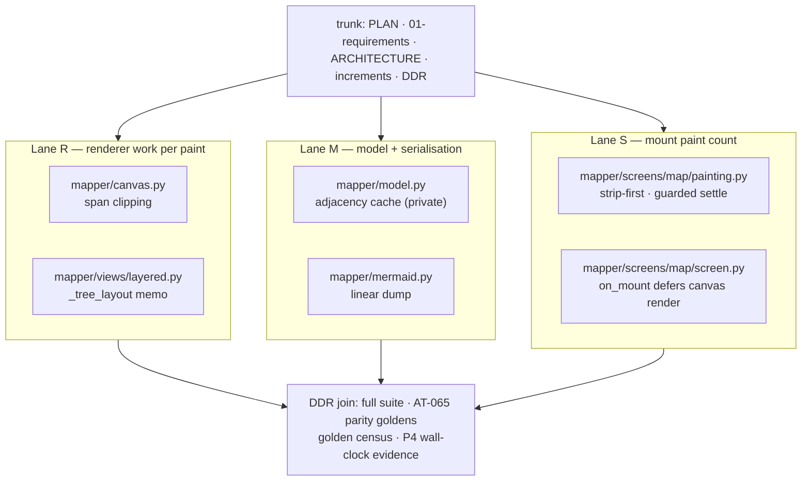
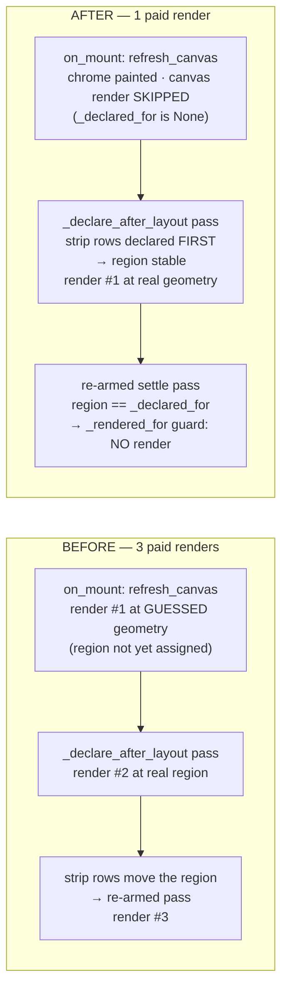

# Design proposal — mapper — Batch 2026-10-10-perf-batch

> **Artifact language.** Canonical **English scaffold**; generate in the batch's language
> The normative rules below are language-independent. **Where that language is declared:**
> `state.json`'s `language` key in `core` and `full`.

> **Reserved field names.** The **field names and block keywords below are language-independent** — the
> validator parses them literally and they are never translated:
> `Design proposal` · `7 · Forward-applicability table` · `⏸ DEFER`
> Everything else on this page — headings, guidance, the prose in every cell — is translated with the batch.
> **One strategy, not two:** the flow ships no alias table, so a translated label is read as an ABSENT one and the rule keyed on it reports a true-sounding silence.
> **Why a HEADING is reserved here and a FIELD NAME everywhere else:** `C-49`'s artifact is the §7 TABLE, and a rule that read a summary bullet instead of the rows would be reading a claim about the table rather than the table. `V52` therefore keys on this document's own H1 and on the §7 heading, which is why both are on the machine plane. **And one FLOW-WIDE reserved token, read out of this artifact by `V42` no matter which template minted it:** `⏸ DEFER`. It is a MARKER rather than a field name, which is why it is stated here *and* in `/dev-flow` §Language of artifacts rather than in a per-template list — a deferral can be written in any batch artifact, including the ones that carry no block at all.

> **Owed in.** `core` by trigger · `full` ✓
> **Source:** `/dev-flow-init` step 4's seed-by-level table, which is this fact's one home. A level marked `—` **does not owe this artifact, and its absence is not an omission**; `by trigger` means the station exists only when the `triggers` block fired, and `stations_active` in `state.json` is the authority for *this* batch. Where a SECTION or a gate row is owed more narrowly than the artifact, it says so on the row.

> **Where this lives: the VAULT + Drive**, not the repo — it is deliberation, and its traceability to
> code is weak. It is **cited by id** from the repo (`PDR-2026-10-10-perf-batch#D<n>`), never copied.
> What binds code — a frozen interface, a design characteristic — also lands in the **repo**, in the
> requirement or in `docs/ARCHITECTURE.md`. *The vault keeps the deliberation; the repo keeps the commitment.*

> **The forward-applicability rule (ISO/IEC/IEEE 15288).** Everything below must be NAMED as the input
> of a later activity. **If a section of this proposal is nobody's input, delete it — it does not belong
> in the PDR.** That rule is what allows this document to cost half the batch without being waste.

| Field | Value |
|---|---|
| Id | `PDR-2026-10-10-perf-batch` |
| Requirements covered | `US-PERF-001 · US-PERF-002 · US-PERF-003 · HLR-PERF.1 v1 · HLR-PERF.2 v1 · HLR-PERF.3 v1 · LLR-PERF.1.1 v1 · LLR-PERF.1.2 v1 · LLR-PERF.1.3 v1 · LLR-PERF.2.1 v1 · LLR-PERF.2.2 v1 · LLR-PERF.2.3 v1 · LLR-PERF.3.1 v1 · LLR-PERF.3.2 v1` |
| Modules touched (from `docs/ARCHITECTURE.md`) | `canvas` · `views` · `model` · `mermaid` · `map screen` |
| Triggers that fired | `A1 · A2 · A3 · A4 · B1 · B3 · E1 · F1` (per PLAN.md §Triggers; D1 explicitly NOT fired for this scope) |
| Author / reviewers | `architect` (worker unit PERFARQ, Kimi) · `qa-reviewer` (pending, P2) |

---

## 1 · Objective and scope

Bound and reduce the work a large map costs, measured at P0 (`spike/perf-baseline.md` §1–§7):
every navigation key repaints the whole map (0.56–1.71 s/keypress at 2000 nodes, §6; the paint walks
every edge's bus row cell-by-cell through `Canvas.wire` — 23,983,998 `wire` calls for two keypresses on
wide-2000, §7.1); mount pays three full paint passes (layered `render` ncalls=3, §7.2); save is O(N·E)
in the Mermaid dump (18,003,001 genexpr iterations and 6002 O(E) `any` scans for N=6000, §7.3).

The batch ships **behaviour-preserving remedies only: every painted cell stays byte-identical** on every
shape the loader admits (all trees). The oracle is the AT-065 parity goldens (`tests/test_mod_parity.py`,
118 and 87 columns, sha256-pinned) plus `tests/test_repair_golden_census.py`, plus new output-equality
and counted-operations tests per remedy. Numeric thresholds are carried by deterministic call-count /
cell-count oracles — **no wall-clock assertions in the suite** (flaky here, per the
`tests/test_repair_perf_shape.py` docstring); wall-clock before/after is reported once at P4 as evidence
(median of 3, same harness `spike/perf_harness.py` / `perf0c_profile.py`).

Three disjoint lanes (A4 — the first batch to use the modular split for parallel work), one join:

- **Lane R — renderer work per paint** (`mapper/canvas.py`, `mapper/views/layered.py`): clip every
  span to the canvas rectangle before iterating; memoise `_tree_layout` per graph revision so a
  selection-only keypress does not re-layout.
- **Lane M — model and serialisation** (`mapper/model.py`, `mapper/mermaid.py`): a cached adjacency on
  `Graph` invalidated on edge mutation; a linear Mermaid dump. Consumers (`import_csv`'s orphan pass,
  `store._reindex`) get the speedup for free through the unchanged `children_of`/`parent_of` signatures.
- **Lane S — mount paint count** (`mapper/screens/map/painting.py`, `mapper/screens/map/screen.py`):
  one paid render at mount; the `_declare_after_layout` settle pass is kept but its render becomes a
  no-op by construction (strip declared before the canvas render, so the settled region is stable).

What this design will NOT do (operator-ruled, PLAN.md):

- The S-18 work budget / any degradation notice — it changes what is painted (D1); a prototype round
  comes first, this batch does not touch `MAX_RENDER_NODES`'s value or the render guards.
- The dense-DAG cost of B-33 beyond what these remedies give: the per-path re-layout of shared subtrees
  (PERF0 §2, the p73 54.8 s shape) is **⏸ DEFER** — fixing it changes painted coordinates on
  multi-parent graphs (first-parent placement is a design ruling that changes bytes), which is the same
  D1 category. Recorded with its evidence so the S-18 prototype round picks it up.
- B-115 / B-116 / B-117 (slugify, child-before-root, forest root drift — carried).
- YAML load cost (§7.4: 100 % `yaml.safe_load`, O(document) — the format's own price).

## 2 · Modules and boundaries

The authoritative module map is `docs/ARCHITECTURE.md` §2 — this batch changes no boundary; cite, do
not duplicate:

| Module | What it owns here | What it exposes | What it must NOT reach into |
|---|---|---|---|
| `canvas` (`mapper/canvas.py` — Lane R) | `Canvas.elbow_down`'s span loops: clip to `self.w`/`self.h` before iterating; `wire`/`edge`/`elbow_down`/`put`/`text`/`rows` signatures unchanged (§4 row frozen) | Same public surface; out-of-bounds writes were already dropped, clipping only skips the loop iterations that would be dropped | Layout algorithms; diagram semantics (module's own ban); nothing outside `canvas.py` |
| `views` (`mapper/views/layered.py` — Lane R) | `LayeredRenderer._tree_layout` memoised per revision token + hidden set, on the renderer instance; `render`/`painted_ids`/`pan_extent` signatures unchanged; `MAX_RENDER_NODES` value untouched | `IRenderer.render(graph, selected_id, w, h, **kwargs) -> Text` — the frozen contract, unchanged | `views` → textual / `store` / `app` bans respected; no Textual import; the per-render `_child_index` build stays (measured ≤ 0.37 ms — noise, PERF0 §1) |
| `model` (`mapper/model.py` — Lane M) | A **private** cached adjacency on `Graph` (`_`-prefixed, `compare=False, repr=False` — the `csv_collisions` precedent), token-invalidated; `children_of`/`parent_of` return edge-list order / first-match exactly as today | `Graph` value object shape unchanged: `nodes`, `edges`, `root_id`, `csv_collisions`, `focus()` — the frozen §4 row gains one trunk-amended note; `__eq__`/`repr` unchanged | UI, persistence details (module's own bans); no new outbound dependency — the cache is plain dicts |
| `mermaid` (`mapper/mermaid.py` — Lane M) | `dump`'s orphan loop: one O(N+E) incident-membership pass instead of the per-node `any(...)` scan; emission order, dedup set and escaping byte-identical | `parse(src) -> Graph`, `dump(graph) -> str`, `slugify` — frozen, unchanged signatures | UI, network (module's own bans) |
| `map screen` (`mapper/screens/map/screen.py`, `painting.py` — Lane S) | Mount paint sequencing only: the pre-layout canvas render is deferred to the settle pass, and the pagination strip's row budget is declared before `canvas.update` so the settled region is stable; `refresh_canvas`/`_declare_after_layout` names, signatures and F2 call surface unchanged; `BINDINGS` and every class constant untouched (F3) | `MapScreen` (package re-export), F5 surface unchanged | No `mapper.app` import, no concern-module imports (§3 `screens/map` row); no `BINDINGS`/`DEFAULT_CSS`/`@on` in any mixin |

- Boundaries respected as declared in `docs/ARCHITECTURE.md`: ✓ — no §2/§3 boundary moves; the one
  §4 touch (`Graph` row gains a note that a private adjacency cache exists) is a **trunk** act done by
  the orchestrator at the join, never inside a lane.

## 3 · Diagrams

Lane ownership and the join (A4 — file sets disjoint, proved in §8):



Mount paint sequence, BEFORE (measured `render` ncalls=3, PERF0C §7.2) and AFTER (ncalls=1):



Adjacency-cache information flow (Lane M):

```text
Graph.edges (plain list; the ONLY post-construction writers are
  model.py:170 add_edge (append) and screens/map/editing.py:217 (wholesale replace))
        │  validity token = (id(self.edges), len(self.edges))
        ▼
Graph._children / Graph._parents (private dicts, built once per token)
        │  edge-list order preserved (children_of); first match preserved (parent_of)
        ▼
consumers through UNCHANGED signatures: children_of / parent_of
  (minimap painting.py:472,519 · navigation.py:32,35 · searching.py:682 ·
   editing.py:204,215 · coverage.py:151 · factory.py · lane.py ·
   import_csv.py:110 orphan pass · store.py:994 _reindex · mermaid.dump orphan loop)
```

## 4 · Interfaces that change — and which ones FREEZE

| Interface | Current | After | Consumers | **Frozen for the fork?** |
|---|---|---|---|---|
| `Canvas` drawing buffer (§4 row) | `wire` bounds-checks and drops out-of-bounds cells; `elbow_down`/`edge` iterate full spans | Identical signatures and written cells; spans clipped to the rectangle **before** iterating — the skipped cells are exactly the ones `wire` would have dropped | `views` (all renderers), `export` snapshots | **YES — untouched.** Clipping is internal to method bodies; §4 row needs no amendment |
| `IRenderer.render` (§4 row, frozen prose contract) | `render(graph, selected_id, w, h, **kwargs) -> Text`; every render recomputes layout | Identical signature and output; `_tree_layout` memoised on the renderer **instance** keyed `(id(graph), len(edges), len(nodes), root_id, frozenset(hidden))` — renderers are per-screen instances (`screens/map/screen.py:73-75`), so no cross-screen state | `app`, `screens`, `export`, `tests` (patch target on `screens/import_preview.py`) | **YES — untouched.** Instance-private cache, no signature or module-global change |
| `Graph` value object (§4 row) | `children_of`/`parent_of` linear-scan `self.edges` per call — O(E) | Identical signatures, order and first-match semantics; a private `_`-prefixed cache with `compare=False, repr=False`, token `(id(edges), len(edges))` | `store`, `views`, `mermaid`, `github`, `app`, the whole `screens` tree | **YES — shape frozen; ONE trunk amendment at the join** notes the private cache field (same precedent as `csv_collisions`). No lane edits the §4 row |
| `MermaidImporter/Exporter` (§4 row) | `dump`'s orphan loop is O(N·E): `any(...)` rescans all edges per node (`mermaid.py:152-153`) | Identical emitted text; orphan membership read from one O(N+E) incident set (the LLR-PERF.2.1 cache or a local pass) | `app`, `store` (round-trip check), `tests` | **YES — signatures and bytes frozen** |
| F1 state roster | 30 attributes incl. `_rendered_for`, `_declared_for` | Unchanged — Lane S uses `_declared_for is None` as the never-declared signal; **no new attribute** | 11 mixins | **YES — no census amendment needed** |
| F2 cross-concern method surface | `refresh_canvas`, `_declare_after_layout`, `_canvas_size`, … names+signatures | Unchanged; Lane S edits **bodies only** (`on_mount`, `refresh_canvas`'s internal order) | mixins, `app` | **YES — names/signatures untouched** |
| F3 core class surface | `BINDINGS` + all class constants on `screens/map/screen.py` | Untouched — Lane S edits `on_mount`'s body only | mixins (read-only), `app` | **YES** |
| F4 patch surface | `MAX_RENDER_NODES` read from `screens/map/searching.py`, bound at `views/layered.py:18`; `LayeredRenderer` patched on `screens/import_preview.py` | Untouched — Lane R keeps the constant, the guards and the module-global binding exactly where they are | `tests` patch sites | **YES — the constant's VALUE is S-18 territory, out of scope** |
| F5 app↔screen surface | `has_pending_draft()`, `guard_open()`, `_guard_draft(...)`, `isinstance(s, MapScreen)` | Untouched | `app`, `widgets` | **YES** |
| `app.py` re-export block / `__all__` | Re-exports of moved names | Untouched — **no lane edits `mapper/app.py`** | every batch's tests | **YES — named shared seam; lanes must not touch it** (B-111) |
| `KEYMAP` seat / darkside tokens | Data-only seat; Rich-only design system | Untouched — no new keys, no new painted strings this batch | `screens`, `widgets`, `app` | **YES** |

**A frozen interface is not touched inside a lane.** If a lane needs to change one, the work returns to
the trunk — that is trigger **A3**. The single §4 amendment (Graph cache note) and any increment packet
that must cross a seam are trunk acts, scheduled at the join (§8).

## 5 · Proposed test cases

| Id | Layer (0 unit / A white / B black / UX) | What it asserts | **The mutation that would turn it RED** |
|---|---|---|---|
| AT-075 — `tests/test_perf_paint_clip.py -k at075` (US-PERF-001, HLR-PERF.1, LLR-PERF.1.1) | B | Wide-2000 tree map in a tmp workspace, opened with real keys (`MapperApp(tmp_path)` + `run_test(size=(118,34))`, helpers from `tests/test_draft_save.py`); two navigation keypresses (`l`, `j`) with a counting wrapper on `Canvas.wire`: total `wire` calls ≤ 4,800,000 (≥ 5× below the measured baseline 23,983,998 for 2 keys, PERF0C §7.1) AND the settled painted lines byte-equal the pinned golden | M-R1a: remove the span clip in a tmp copy → `wire` calls jump back to ~24 M → count RED. M-R1b: an off-by-one clip (`< self.w` as `<= self.w`) → byte-golden RED |
| AT-075b — `tests/test_perf_layout_memo.py -k at075b` (US-PERF-001, LLR-PERF.1.2) | B | Same map; five selection-only keypresses (`l,j,j,j,j`): `_tree_layout` computed exactly once; painted output after each key byte-equal the pinned golden; then an edit that mutates edges (archive a subtree with real keys) and one more keypress: layout recomputes (stale-cache detector) | M-R2: drop the memo in a tmp copy → layout computed 5× → count RED. M-R2b: never invalidate (fixed token) → post-edit painted diff RED |
| AT-076 — `tests/test_perf_dump.py -k at076` (US-PERF-002, HLR-PERF.2, LLR-PERF.2.2) | B | Save a wide-6000 map through the real app (`ctrl+s`), a counting wrapper on `graph.edges`: total edge iterations during save ≤ 3·(N+E) (baseline: 18,003,001 genexpr visits + 6002 O(E) scans, PERF0C §7.3) AND the saved `.mmd` bytes byte-equal the pinned golden | M-M2a: restore the per-node `any()` scan in a tmp copy → iteration count RED. M-M2b: reorder the orphan loop → byte-golden RED |
| AT-077 — `tests/test_perf_mount.py -k at077` (US-PERF-003, HLR-PERF.3, LLR-PERF.3.1) | B | Mount a wide-2000 map with real keys: the current renderer's `render` is called exactly **once** between `push_screen` and a settled first paint (baseline 3, PERF0C §7.2); rail, minimap, inspector and crumb painted (chrome not regressed); canvas + strip byte-equal the pinned golden | M-S1: restore the eager pre-layout canvas render in `on_mount` (tmp copy) → render ncalls=2 → count RED |
| AT-077b — `tests/test_perf_mount.py -k at077b` (US-PERF-003, LLR-PERF.3.2) | B | The B-56/B60 scenario: mount at 87×34 (and at a reflow size such as 60×20) — the pagination strip reports the hidden-row numeral at the real settled geometry | M-S2: neuter the `_declare_after_layout` settle pass in a tmp copy → the absent-numeral defect returns → strip-text RED |
| `tests/test_perf_paint_clip.py` — `-k identity` (LLR-PERF.1.3) | 0 | Output-equality across the fixture grid — empty map, single node, deep chain 5000, wide 6000, forest (≥ 2 parentless nodes), multi-parent DAG built directly (never saved): clipped render bytes == reference render bytes (clip disabled), and AT-065 parity goldens + `test_repair_golden_census.py` stay green after Lane R lands | Any clip that drops an in-bounds cell → fixture diff RED; a parity-golden mismatch → RED |
| `tests/test_perf_adjacency.py` — `-k cache` (LLR-PERF.2.1) | 0 | Correctness + counted ops: cached `children_of`/`parent_of` results equal the linear-scan reference (order- and first-match-exact) across a mutation script — build wide-6000, warm the cache, `add_edge`, wholesale `edges` replacement (archive simulation), `focus()` subgraph; then 100 mixed lookups with a counting wrapper on `graph.edges`: total edge visits ≤ 1 full scan (baseline 100·E) | M-M1a: bypass the cache → visit count RED. M-M1b: key the cache on `len(edges)` only and replace the list with a same-length one → stale results → equality RED |
| `tests/test_perf_adjacency.py` — `-k census` (LLR-PERF.2.1 guard) | 0 | The edge-mutation census is AST-derived: `\.edges` post-construction writers ⊆ {`model.py` `add_edge` body (append), `screens/map/editing.py` `_remove_subtree` (assignment)} — the soundness basis of the `(id, len)` token | M-M1c: add any new `graph.edges.append/.extend/.insert/.remove/.pop` or `.edges =` site in a tmp copy → census guard RED (this is the cache-invalidation tripwire) |
| `tests/test_perf_dump.py` — `-k fixtures` (LLR-PERF.2.2) | 0 | `dump(parse(f))` and `dump(G)` byte-equal pinned goldens for `fixtures/legacy.mmd`, `fixtures/anidado.mmd`, `fixtures/truncado.mmd`, wide-6000, forest, empty and single-node graphs | M-M2b (emission order/dedup change) → fixture byte RED |
| `tests/test_perf_mount.py` — `-k chrome` (LLR-PERF.3.1) | A | With the canvas render deferred at mount, the rail/minimap/inspector/crumb still paint on the first pass (they are geometry-independent) and the error-graph path (a refused map's 1-node error graph) still paints | M-S3: make the deferral skip `refresh_canvas`'s chrome painting too → chrome assertion RED |

**Declared here, at authoring time, not at execution time.** A proposed case whose reddening mutation
cannot be named is not yet a test case — it is a hope.

## 6 · Risks and rejected alternatives

> **Rejected alternatives are owed WHERE A REAL DECISION EXISTS**, otherwise `n/a — <the decision already made, and by what>` — an existing pattern, a frozen interface, a prior ADR. **Do not fabricate a second design to fill this section:** two invented options make an arbitrary pick look deliberated, which is worse than one honest constraint. (the same ruling as `agents/architect.md` §Evidence checklist and the PDR row — one obligation, three stations, and closing it at one of them is `C-14`.)

| Alternative considered | Why it was rejected |
|---|---|
| S-18 work budget / degradation notice (PERF0 §4 remedy 2) | Changes **what** is painted — operator-ruled OUT (D1 not fired for it); needs the prototype round first. PLAN.md §Risks already carries it |
| Single-visit `_tree_layout` for shared subtrees (PERF0 §4 remedy 1, the p73 54.8 s / 534 M `wire` shape) | **⏸ DEFER** — byte-identical paint is the batch's contract, and on multi-parent graphs first-parent placement paints *different* cells; it is D1-category work and belongs to the S-18 prototype round, which inherits the measured evidence (271 k path-visits, slot inflation) and the first-parent-placement ruling sketch. Reachable today only via CSV preview (the loader refuses multi-parent saves), so no user-visible regression ships by deferring |
| Memoising full `_geometry` (incl. `_tree_layout`) keyed on the whole `ViewState` | `w`/`h` are in every keypress's changed state only on resize, but the `widest`-title scan and visible-set walk make a sound key heavier than the 0.11 s layout itself at admissible shapes (PERF0 §2: layout 2.9 s vs paint 128 s on p73 — paint dominates; on reachable trees `_geometry` is ~N and noise). Memoising `_tree_layout` alone (title-independent, structural) is the cheap sound subset |
| Wall-clock assertions in the suite | Rejected by measured precedent: `tests/test_repair_perf_shape.py`'s docstring — an 8 s budget measured at 2.6–3.4 s went 10.36 s under concurrent load (~10 % flaky). All thresholds here are call-count/cell-count oracles; wall-clock runs once at P4 as evidence (median of 3, subprocess, same harness) |
| Lane M: eager adjacency build in `Graph.__init__` / a public adjacency interface | `import_csv` and `mermaid.parse` construct a `Graph` then `add_edge` row by row — eager building rebuilds per edge; lazy-on-first-access is O(1) until needed. A public cache is an A3 on the frozen `Graph` row — the cache is private and invisible through the named interface |
| Lane M: explicit invalidation method called from every mutation site | The census would have to be re-verified by hand at every future edit; the `(id(self.edges), len(self.edges))` token invalidates automatically on both existing writer shapes (append, wholesale replace) and needs **zero** call sites outside `model.py` — and the AST census guard (`-k census`) makes a new writer site a RED test instead of a latent bug |
| Lane S: deleting the `_declare_after_layout` settle pass | It exists for a measured defect (B-56/B60: the strip read "nothing hidden" while half the map was off-screen at 50×20/60×20, and ordinary navigation did not heal it — `painting.py:366-377` docstring). Deleting it reintroduces the absent numeral; the design keeps the pass and makes its settled render a no-op by declaration order |
| Lane S: deferring by Textual timing (`call_after_refresh` batching, timers) | The pass exists precisely because compositor timing is unreliable (31×1 → 29×2 → 31×3 reflow); relying on more timing adds races. The fix is structural: declare the strip's row budget (content-derived, geometry-independent) before `canvas.update`, so the first real-geometry render lands in the settled region |
| Lane R: consuming the model adjacency cache in the renderers | A3 — it would couple Lane R to Lane M's file. The renderers' own `_child_index` build is measured ≤ 0.37 ms per pass (PERF0 §1) — noise. Pinned by LLR-PERF.2.3 |

*(Recording the rejection is what stops the same option being re-proposed in three batches.)*

Risks that remain, with their guard (the main one named first):

- **Cache invalidation bugs (Lane M) — the batch's main risk.** The `(id, len)` token is sound **only
  if** the census holds: every post-construction writer of `edges` changes the list's identity or
  length. Census (executed at P1, grep + AST over `mapper/`): `model.py:170` `add_edge` (append — len
  changes); `screens/map/editing.py:217-219` `_remove_subtree` (wholesale list assignment — id changes);
  **no** `.edges.append/.extend/.insert/.remove/.pop` anywhere else; **no** aliased edge lists (every
  construction — `mermaid.py:114-120` parse, `model.py:245-251` `focus`, store load, `import_csv` —
  builds a fresh list); undo restores a **new** `Graph` (`undo.py:60-61`), so caches die with the object.
  A writer that mutates in place keeping both id and len (none exists today) would slip the token — that
  is exactly what the AST census guard (`-k census`, M-M1c) reddens. Plus LLR-PERF.2.1's mutation-script
  equality arm (add_edge / wholesale replace after warm cache).
- **Clip off-by-one (Lane R).** The byte-identity grid (LLR-PERF.1.3) + AT-065 parity goldens catch any
  dropped or extra in-bounds cell; the clip is a pure loop-bound change inside bodies whose per-cell
  writes `wire` already bounds-checks (`canvas.py:107-109`).
- **Stale layout memo (Lane R).** Key `(id(graph), len(edges), len(nodes), root_id, frozenset(hidden))`
  covers every `_tree_layout` input (structure + hidden prune); a title-only ficha edit must NOT
  invalidate (layout is title-independent) and must NOT repaint differently — pinned by the byte-equality
  arm of AT-075b; the edit-then-keypress arm pins invalidation fires when edges change.
- **Mount deferral edge cases (Lane S).** The error-graph path (refused map → 1-node graph) must still
  paint — the deferral skips only the canvas render on the never-declared path, not chrome or the
  degraded-path paint (`_rendered_for` is set on the degraded path too, `painting.py:630`); AT-077's
  chrome arm (M-S3) and AT-065's scripted open cover it. `_declared_for` is cleared and re-armed each
  pass — the "never declared" signal is only true at mount, which is the only place the deferral reads it.
- **Cross-lane drift.** Lanes share no file (§8); the join re-runs the full suite + parity + census, so
  a lane that breaks another lane's oracle is caught at the DDR, not in production.

## 7 · Forward-applicability table — **the section that makes this document honest**

| Output of this PDR | Named consumer downstream | Where the consumer will read it |
|---|---|---|
| Lane R design (span clip + `_tree_layout` memo, byte-identity grid) | increments Inc-R1/Inc-R2; the DDR join | `03-increments/increment-001.md`; `04-validation.md`; `tests/test_perf_paint_clip.py`, `tests/test_perf_layout_memo.py` |
| Lane M design (private adjacency cache + `(id, len)` token + census guard; linear dump) | increments Inc-M1/Inc-M2; the trunk's ARCHITECTURE §4 Graph-row note; the S-18 round (dump stops being the save-floor cost) | `03-increments/increment-001.md`; `docs/ARCHITECTURE.md` §4 (trunk amendment); `tests/test_perf_adjacency.py`, `tests/test_perf_dump.py` |
| Lane S design (strip-first declaration order + guarded settle; mount = 1 paid render) | increment Inc-S1; the DDR join | `03-increments/increment-001.md`; `tests/test_perf_mount.py` |
| The edge-mutation census (model.py:170 + editing.py:217, none else) | LLR-PERF.2.1's token soundness; the AST guard test; every future batch that mutates `Graph.edges` | `01-requirements.md` §2.7 premise 4; `tests/test_perf_adjacency.py -k census` |
| The ⏸ DEFER record (single-visit DAG layout + S-18 budget, with PERF0 §2 evidence) | the S-18 prototype round | `.dev-flow/BACKLOG.md` (B-33 carry) and the prototype batch's P0 |
| Proposed test cases (§5) with named reddening mutations M-R1a/b, M-R2/b, M-M1a/b/c, M-M2a/b, M-S1/2/3 | Phase-3 increments author their gate checks from these rows; the DDR verifies each AT owns its node with an executed RED | `04-validation.md`; `design/DDR-2026-10-10-perf-batch.md`; increment packets under `03-increments/` |
| P4 wall-clock evidence protocol (median of 3, `spike/perf_harness.py` / `perf0c_profile.py`, evidence not assertion) | the P4 validation report | `04-validation.md`; `05-postmortem.md` |
| design → requirement traceability | the matrix and the DDR | `04-validation.md` traceability matrix (each HLR/LLR row cites this PDR's §4/§5 rows) |

- ⚠ Any row whose consumer column is empty: **remove the output, or explain why it is being produced.** — none; every row names a consumer.

## 8 · Parallelisation plan *(only if the batch forks)*

The batch forks into three lanes after this PDR — the first batch to use the modular split for
parallel work (A4). Lane file sets (source + tests):

| Lane | Modules / layer | Files it owns | Agent |
|---|---|---|---|
| Lane R — renderer work per paint | `canvas`, `views` / layer 0+A | `mapper/canvas.py`, `mapper/views/layered.py`, `tests/test_perf_paint_clip.py`, `tests/test_perf_layout_memo.py` | worker |
| Lane M — model and serialisation | `model`, `mermaid` / layer 0 | `mapper/model.py`, `mapper/mermaid.py`, `tests/test_perf_adjacency.py`, `tests/test_perf_dump.py` | worker |
| Lane S — mount paint count | `map screen` (painting + core lifecycle) / layer A+B | `mapper/screens/map/painting.py`, `mapper/screens/map/screen.py`, `tests/test_perf_mount.py` | worker |
| Trunk (join) | all / gate | requirements, PLAN, ARCHITECTURE §4 note, `03-increments/`, `04-validation.md`, `design/DDR-2026-10-10-perf-batch.md` | orchestrator |

- `modules(lane_i) ∩ modules(lane_j) = { }` — ✓ (three lane module pairs are pairwise disjoint).
- **File sets are disjoint** (not just modules — two lanes may not edit the same file, not even different regions): ✓ — executed intersection test at P1: `R∩M = R∩S = M∩S = ∅` (printed: `R&M: set() R&S: set() M&S: set()`).
- Family-B reverse census run **per lane and shared** before forking: ✓ — executed at P1: 23 test files assert renderer/`children_of`/`parent_of` symbols, 19 assert the mount/paint path (`grep -rlE ... tests/*.py | wc -l`); the load-bearing consumers are: `tests/test_mod_parity.py` (painted text, all lanes), `tests/test_repair_golden_census.py` (renderer output at 4 sizes, Lane R), the store round-trip + CSV suites (Lane M's `dump`/`children_of` order), AT-065 and the B-56/B60 mount tests (Lane S). No lane's file set is edited by another lane's symbols.
- Trunk-only artifacts (requirements · traceability · backlog · SPEC) are written **only** by the trunk: ✓ — this PDR, `01-requirements.md`, the ARCHITECTURE §4 note and the increment packets are written only by the orchestrator; lanes receive them read-only.

**Shared seams a lane must not touch** (frozen interfaces + trunk artifacts, per ARCHITECTURE §4 and
backlog B-111): `BINDINGS` and every class constant on `screens/map/screen.py` (F3); the F2
cross-concern method names/signatures (bodies only); F5's `has_pending_draft`/`guard_open`/`_guard_draft`;
the `mapper/app.py` re-export block / `__all__` and F4 patch bindings (`MAX_RENDER_NODES`'s value is
S-18 territory — Lane R keeps it byte-for-byte); `mapper/keymap.py` and `mapper/darkside.py`; the
`Canvas` and `IRenderer.render` public signatures; `docs/ARCHITECTURE.md` itself (the one §4 Graph-row
note is the trunk's join act); and the other lanes' files.

**Increment plan per lane** (each ≤ 4 source files, smallest-first):

- **Lane R** (2 source files): Inc-R1 — `canvas.py` span clipping + `tests/test_perf_paint_clip.py`
  (count + byte-identity grid). Inc-R2 — `layered.py` `_tree_layout` memo + `tests/test_perf_layout_memo.py`.
- **Lane M** (2 source files): Inc-M1 — `model.py` private adjacency cache + token + `tests/test_perf_adjacency.py`
  (equality script, counted ops, AST census guard). Inc-M2 — `mermaid.py` linear orphan pass + `tests/test_perf_dump.py`.
- **Lane S** (2 source files): Inc-S1 — `painting.py` strip-first declaration order + `screen.py`
  `on_mount` deferral + `tests/test_perf_mount.py` (one increment; the two edits are one mechanism).

**Join (DDR) plan.** Lanes land in any order (disjoint files); after each lane lands, its own new tests
+ the full suite run green on the trunk. The DDR then: (1) re-runs the suite; (2) verifies AT-065
parity goldens and `test_repair_golden_census.py` byte-unchanged (the batch's behaviour oracle); (3)
executes every named negative control (M-R1a/b, M-R2/b, M-M1a/b/c, M-M2a/b, M-S1/2/3) as transcripts;
(4) writes the P4 wall-clock evidence table with the P0 harness (keypress, mount, save — median of 3,
subprocess, against the §6/§7 baselines); (5) the trunk amends ARCHITECTURE §4's `Graph` row with the
private-cache note. Any lane found to have touched a frozen seam returns that increment to the trunk
as an A3 — it is never improvised inside the lane.
