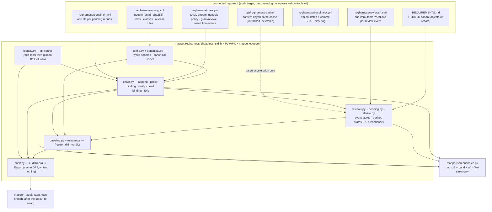

# Design proposal — mapper — Batch 2026-10-11-reqharness-batch

> **Artifact language.** Canonical **English scaffold**; generate in the batch's language
> The normative rules below are language-independent. **Where that language is declared:**
> `state.json`'s `language` key in `core` and `full`.

> **Reserved field names.** The **field names and block keywords below are language-independent** — the
> validator parses them literally and they are never translated:
> `Design proposal` · `7 · Forward-applicability table` · `⏸ DEFER`
> Everything else on this page — headings, guidance, the prose in every cell — is translated with the batch.
> **One strategy, not two:** the flow ships no alias table, so a translated label is read as an ABSENT one and
> the rule keyed on it reports a true-sounding silence.
> **Why a HEADING is reserved here and a FIELD NAME everywhere else:** `C-49`'s artifact is the §7 TABLE, and
> a rule that read a summary bullet instead of the rows would be reading a claim about the table rather than
> the table. `V52` therefore keys on this document's own H1 and on the §7 heading, which is why both are on
> the machine plane. **And one FLOW-WIDE reserved token, read out of this artifact by `V42` no matter which
> template minted it:** `⏸ DEFER`.

> **Owed in.** `core` by trigger · `full` ✓
> **Source:** `/dev-flow-init` step 4's seed-by-level table, which is this fact's one home. A level marked
> `—` **does not owe this artifact, and its absence is not an omission**; `by trigger` means the station
> exists only when the `triggers` block fired, and `stations_active` in `state.json` is the authority for
> *this* batch. Where a SECTION or a gate row is owed more narrowly than the artifact, it says so on the row.

> **Where this lives: the VAULT + Drive**, not the repo — it is deliberation, and its traceability to
> code is weak. It is **cited by id** from the repo (`PDR-2026-10-11-reqharness-batch#D<n>`), never copied.
> What binds code — a frozen interface, a design characteristic — also lands in the **repo**, in the
> requirement or in `docs/ARCHITECTURE.md`. *The vault keeps the deliberation; the repo keeps the commitment.*

> **The forward-applicability rule (ISO/IEC/IEEE 15288).** Everything below must be NAMED as the input
> of a later activity. **If a section of this proposal is nobody's input, delete it — it does not belong
> in the PDR.** That rule is what allows this document to cost half the batch without being waste.

| Field | Value |
|---|---|
| Id | `PDR-2026-10-11-reqharness-batch` |
| Requirements covered | `US-RH-001 · US-RH-002 · US-RH-003 · HLR-RH.1 … HLR-RH.9 · LLR-RH.1.1 … LLR-RH.8.6` (initial authoring at P1, unit RH1; round-1 review rulings R1–R14 + D13 applied at P1 iteration 1, unit RH2, ledger `LED-2026-10-11-reqharness-batch.3`…`.17`; round-2 review rulings R15–R26 applied at P1 iteration 2, unit RH3, ledger `LED-2026-10-11-reqharness-batch.18`…`.29`) |
| Modules touched (from `docs/ARCHITECTURE.md`) | NEW `reqharness` (`mapper/reqharness/*.py`) · `screens` (gains `mapper/screens/roles.py` — named on the ARCH `screens` row by the R11/R19 amendment) · `keymap` (gains the `roles` scope — declared-seat edit owned by the roles-screen increment 6a) · `app` (gains the `--audit <repo>` branch in `main()`) |
| Triggers that fired | `A1 · A2 · A3 · B1 · C1 · C4 · C6 · C8 · D1 · E1 · E2 · F1` (per `state.json` `triggers`, evaluated 2026-10-11; PLAN.md §Triggers) |
| Author / reviewers | `architect` (worker unit RH1, Kimi) · round-1 reviewers `architect` / `qa-reviewer` / `security-reviewer` (2026-10-11, verdict iterate-to-refine; rulings R1–R14 + D13 applied in unit RH2) · round-2 reviewers `architect` (iterate, text-only), `qa-reviewer` + `security-reviewer` (approve-with-conditions; rulings R15–R26 applied in unit RH3) |

---

## 1 · Objective and scope

mapper becomes the harness for dev-flow's human-auditable artifacts (B-107; operator rulings B-119 D1,
B-121, B-122; prototype verdict B-123; orchestrator P0 rulings, `state.json` `decisions_log` 2026-10-11;
round-1 review rulings R1–R14 + D13, 2026-10-11; round-2 review rulings R15–R26, 2026-10-11). This
batch ships the coherent vertical slice:

1. **The headless domain core** — package `mapper/reqharness/`: typed-schema configuration
   load/validate with genesis creation, bound to the chain by admin-approved `policy` events (R1);
   the hash-chained role log (`reqharness/roles.yml`, YAML multi-document stream, one approved event
   per document, admin-only approval, no self-approval, genesis declared once, `policy` events binding
   sha256(canonical config), head binding on every event, fork detection with deterministic exclusion
   and a `resolve`-event recovery (R7/R16)); review events (`reqharness/reviews/`, one immutable YAML file per event,
   named `<yyyymmdd>-<sha8 of canonical content>.yml`, bound to the object's normative digest AND the
   chain head, role-checked at the bound head); pending requests (`reqharness/pending/`, one file per
   request, resolved by `a`/`r` into chain events that reference the request hash — R6); derived object
   states with an explicit precedence table (R5); baselines (named + commit SHA + dirty flag, frozen
   under `reqharness/baselines/<name>.yml`, diff two baselines or baseline-vs-now over five classes —
   R13/R24; `reactivated` + review-state progression deferred, B-125); release-rule evaluation with the
   hard-coded mandatory rules (R1/R5) and the
   `not ready · registry not verifiable` block; the read-only `mapper --audit <repo>` CLI entry (cache
   OFF, writes nothing — R4); a content-keyed parse cache inside `.git/reqharness-cache/` (R4); an
   identity reader over a hardened read-only git allowlist (R11/R20); YAML loading through a custom
   loader subclass on `yaml.CSafeLoader` when available, `yaml.SafeLoader` otherwise — never
   `yaml.load` with any other loader (R-SCALE a + R21; the claim is backed by a source census +
   fallback-loader test, R14); strict input limits (R9).
2. **The roles screen** — matrix variant B (B-123 verdict) at `mapper/screens/roles.py`: people × roles
   grid (● in force · ◐ pending add · ◌ pending remove · ○ not held), cursor cell to cell, `space`
   proposes inline, `a`/`r` resolve pending (admin only, never one's own — R6); the status band
   (event count, head hash, viewer identity, pending detail, chain status, release verdict — R14) in
   the screen footer; the tampered/forked state makes the matrix read-only with `space` inert and a
   message (R14); reachable from home with one key (seat edit owned by the roles-screen increment 6a,
   which also owns the `screens/home.py` door row; the admin `a`/`r` resolution lands in increment 6b —
   R25).
3. **The D12 proposal document** — a 06-docs document at P6 proposing that dev-flow's 05-close human
   review ledger be *derived* from the registry.

Objects of record for this batch are the **HLR/LLR rows of `REQUIREMENTS.md`** only. The **US canon and
the AT → test-node table are FOLLOW-UP** (B-next-2, with the dev-flow adapter spike) and are named as
such in `01-requirements.md` §1.2.

What this design will NOT do (operator-ruled, PLAN.md §Out-of-scope carries):

- Review/signing screen and baseline/release view — follow-up batches, each with a prototype round first
  (standing authorization condition; D1 fired for the roles screen only, which already holds verdict B-123).
- US canon + AT → test-node extraction, dev-flow read-only adapter (D5), graduated edge (D2), (batch,id)
  keys (D7), tolerant `(retired)` parser (D9), owner enum (D10), depth cap (D11) — follow-up batch.
- Generated MD/HTML views (B-121 ruling 5 — never a second source).
- Evidence capture `e` (D3, gated on `security-check-before-tools`); B-122 optional strong mode
  (CODEOWNERS + branch protection + signed commits) — the residual layer-3 risk is stated honestly in
  the threat model instead (§2.1).
- Any network, subprocess-write, or OS-handler crossing: the core reads and writes only files under
  `reqharness/` in the connected repo plus its cache inside `.git/reqharness-cache/`; the only
  subprocesses are the hardened read-only git allowlist commands (R11/R20/R27): `git rev-parse`
  (`--show-toplevel` and `HEAD`), `git config --get user.name|user.email` (repo-local then global),
  and `git status --porcelain --no-optional-locks` ONLY inside `Baseline.create` — `--audit` runs
  NO `git status` (R27a; the dirty flag is baseline-only, in the operator's own repo, residual:
  "baseline creation trusts the repo's `.git/config`") — every call an argv list with `shell=False`,
  a 10 s timeout, the `<abs git> --no-pager -c core.fsmonitor=false -c core.hooksPath=<os.devnull>
  -C <repo>` form (`git` resolved ONCE to an absolute path by walking PATH itself — the audited repo,
  the cwd, `.` and empty entries excluded, compared resolved; then `git` + each PATHEXT extension on
  Windows, PATHEXT fallback `.COM;.EXE;.BAT;.CMD`; first existing regular file wins — a planted
  `git.exe` in the audited repo's cwd never wins; never `cwd=<repo>` — R27c), `GIT_OPTIONAL_LOCKS=0`
  in the env, and inherited `GIT_DIR`/`GIT_WORK_TREE`/`GIT_CONFIG*` stripped; a `safe.directory`
  refusal or any git non-zero becomes the named result `no repo`, never a crash (R27d). The
  committer-vs-reviewer email warning (a `git log` pass) is **deferred (B-124)**.

## 2 · Modules and boundaries

The authoritative module map is `docs/ARCHITECTURE.md` §2/§3. This batch ADDS one module and amends two
dependency rows; the amendment is a **trunk act inside increment 1** (re-planned by R19 — the round-1
plan had it in the identity increment) — written when the module is created, not claimed earlier (the
round-1 architect finding LOW-d; the staleness rule is satisfied because the amendment lands before any
increment that relies on it is validated). Cited, not duplicated:

| Module | What it owns here | What it exposes | What it must NOT reach into |
|---|---|---|---|
| `reqharness` (NEW — `mapper/reqharness/*.py`: `model.py`, `config.py`, `canonical.py`, `chain.py`, `identity.py`, `reviews.py`, `pending.py`, `derive.py`, `cache.py`, `baseline.py`, `release.py`, `audit.py`, `__init__.py`) | The entire ReqHarness domain core: value objects; typed config schema + validation + genesis creation (policy-bound from the first document — R15); canonical serialisation (R3); the hash-chained role log (append, verify, policy binding, head binding, fork exclusion + `resolve` recovery, effective roles AT A BOUND HEAD); the identity reader (R11/R20); review + pending stores (content-named files, exclusive create, sha8 content check — R8/R22; `osopen` confinement); the content-keyed parse cache in `.git/reqharness-cache/` (R4); derived object states with the R5 precedence table; baselines + diff (R13/R24 classes); release-rule evaluation with the hard-coded mandatory rules; the headless `audit(repo) -> Report` entry the CLI calls (cache OFF, writes nothing). **Headless: stdlib + PyYAML only — no Textual, no Rich, no mapper imports EXCEPT `mapper.osopen` (confinement reuse, R8 — a stdlib-only module; ARCH §3 amended to name the one inbound edge).** | `load_config(repo)`, `Chain.append/verify/effective_roles`, `derive.states(canon, reviews, chain)`, `Baseline.create/diff`, `release.evaluate(...)`, `identity.read(repo)`, `audit(repo) -> Report` — plain dataclasses + str enums, no UI types | **Anything in `mapper` except `mapper.osopen`**; Textual; Rich; network; `subprocess` except the R20-hardened read-only git allowlist |
| `screens` (gains `mapper/screens/roles.py` — the roles-screen increment) | `RolesScreen` (matrix variant B): the people × roles grid, cursor movement, `space` propose, `a`/`r` pending resolution (R6), the footer status band (event count, head hash, viewer identity, pending detail, chain chip, release verdict — R14); read-only matrix with `space` inert in tampered/forked states (R14); ALL file-derived text painted only through `rich.text.Text(...)`/`Text.append` sinks (R10), coerced through `darkside.plain` first. One module per screen, `KEY_SCOPE = SCOPE_ROLES`, `BINDINGS = screen_bindings(SCOPE_ROLES)`, chrome from `mapper/widgets/chrome.py` | `RolesScreen` (re-exported from `mapper.app`, the A5b/A6 precedent) | No persistence decisions — it reads the core and paints; it writes ONLY through the core's append APIs (which enforce the chain rules); no `mapper.app` import |
| `keymap` (the roles-screen increment owns the seat edit — the declared-seat rule, exactly one increment) | New scope `SCOPE_ROLES = "roles"` + group `roles` + the home door `KeyBinding("R", "R", "roles", "roles", "doors")` (uppercase `R`: the shifted-pair precedent already in the seat; lowercase `r` stays `resume`; executed probe: `duplicate_chords()` empty after the row lands — premise 3 of `01-requirements.md` §2.7) | Same data-only surface; still zero dependencies | unchanged — no styling, no widgets |
| `app` (wiring — additive) | `main()` gains one early branch AFTER the UTF-8 stdout re-wrap (`app.py:328`): `mapper --audit <repo>` runs `reqharness.audit(repo)` with the cache OFF, prints the report, exits 0/1 WITHOUT starting the TUI and without writing anything (R4/R11); home gains the roles door wiring + the `screens/home.py` door row (owned by the same increment) | `MapperApp`, `main`; new re-export `RolesScreen` | unchanged bans |

- Boundaries respected as declared in `docs/ARCHITECTURE.md`: ✓ with the declared amendments above
  (new `reqharness` §2 row + §3 rows `reqharness` → `osopen` only / `screens`,`app` → `reqharness`;
  the `screens` row names `roles.py` as the reqharness edge — R11) — the amendment is written inside
  increment 1 (R19), before the increments that rely on it are validated; no §4 frozen row changes.

### 2.1 · Security analysis (family C — what the design gives, and what it cannot)

**Threat model (rewritten per the round-1 security review; layers, attacker, guarantee, residual).**

- **Layer 1 — accidental or unapproved edits by a committer without approval.** Attacker: anyone who
  can commit but does not hold `admin`. Guarantee: the hash chain detects any hand edit to
  `roles.yml` (verify fails at the first broken document; the last verified prefix stays in force; the
  state word is `config changed without approval`); a hand edit to `config.yml` is detected through
  the policy binding — the sha256(canonical config) recorded by the last admin-approved `policy` event
  no longer matches, so the policy is the last approved one and the release is blocked (R1). Review
  files are immutable append-only events; a modified review is detected through the sha8 content check
  (R22) or its recorded head (`roles_seq`/`roles_hash`) leaving the chain, or through a baseline
  comparison reporting `deleted` (R2/R13). **Residuals (R23):** a deleted review is detected only
  against a baseline that listed it; truncation of tail events no review or baseline has bound yet
  verifies clean; `reviewer` is free text (identity is git config). **No further residual at this
  layer** beyond availability (a determined committer can always refuse to merge fixes — outside the
  threat model).
- **Layer 2 — an unentitled or stale reviewer.** Attacker: a reviewer without the designated role, or
  a reviewer reviewing outdated content. Guarantee: authority is evaluated at the bound head, never
  at wall-clock time; a review whose signer held no designated role at its bound head derives
  `pre-reviewed`, is flagged `unentitled`, and never blocks the release by itself; a review on a
  stale digest never closes; a newer pre-review never downgrades a qualifying human review on the
  same digest; `not verifiable` is reserved for chain/policy breaks and unknown heads (R2/R5). Model
  reviews are self-declared (`kind: model`) and are pre-review only — the design says so wherever the
  kind is named. **Residual (R17):** old-head binding — a revoked reviewer can bind a NEW review to an
  older head where they still held the role; `--audit` WARNS when a review's bound head precedes a
  later revocation of its signer's role (a core comparison over the chain, no git); layer 3 remains
  the strong answer. Also: self-declared model kind is trusted as declared (a human could label
  their review `kind: model` — it then never closes anything, which fails safe).
- **Layer 3 — a writer with full repo access rewriting the world consistently.** Attacker: a
  committer who rewrites `roles.yml`, every review event, and every recorded head TOGETHER, so the
  chain verifies and every head matches. Guarantee: **none in this batch** — sha256 is integrity and
  append-order proof, not a signature, and nothing anchors genesis to git history. **Residual risk,
  stated:** a full consistent rewrite by a writer with repo access defeats every mechanism above; the
  answer is B-122 layer 3 (signed commits / CODEOWNERS / branch protection) — a named follow-up, out
  of scope. Git anchoring of the genesis event is a follow-up too (R2). Backdating within a verified
  chain (`time` is self-declared) is bounded by head binding: authority is at the bound head and
  `time` must be non-decreasing, so a backdated grant cannot retro-authorize a review bound to a
  later head.
- **Layer 0 — hostile input.** Attacker: any file under `reqharness/`. Guarantee: typed schema with
  unknown/missing keys rejected; the writer always quotes scalars so the reader never coerces
  (R3); limits — ≤ 64 KB per review/pending file, ≤ 4 MB roles.yml, ≤ 100 000 review files; YAML
  anchors/aliases and duplicate keys rejected; deep-nesting errors caught as in `mapper/store.py:706-720`;
  malformed or oversize files reported BY NAME, never silently skipped (R9); path confinement reuses
  `mapper.osopen.confine_reason` / `is_link` — `..`, links and junctions refused (R8); file-derived
  text reaches the screen only through `rich.text.Text(...)`/`Text.append` sinks and passes
  `darkside.plain` first (R10). Emails are stored only as `email_sha256` — no personal data in clear
  beyond display names (R12).

- **C1 (auth).** The chain IS the authorization mechanism for role changes: only `admin` approves;
  `requested_by == approved_by` is rejected for role changes about oneself; effective roles come from
  the verified prefix folded AT A BOUND HEAD. NOTHING is "authorized at write time" this batch — there
  is no review write API; reviews are re-checked at derive/release time (the round-1 wording
  correction). **Honest ceiling:** reviewer identity is `git config user.name` / `user.email`
  (repo-local then global, R11) — self-claimed, spoofable by anyone who can commit; and anyone with
  commit access can rewrite `roles.yml` AND its chain together (layer 3 above). The mechanism detects
  accidental edits, unapproved changes, stale or unentitled reviews, and audit-trail disputes — not a
  determined insider. B-122's strong mode is the named upgrade, out of scope this batch, stated in the
  requirements (LLR-RH.4.4). The committer-vs-reviewer email binding (`git log` warn pass) is
  **deferred (B-124)** — round-2 ruling R20 removed `git log` from the allowlist.
- **C4 (sensitive/trust surface).** New versioned files at the connected-repo root: `reqharness/config.yml`,
  `reqharness/roles.yml`, `reqharness/reviews/*.yml`, `reqharness/pending/*.yml`,
  `reqharness/baselines/*.yml`, plus the untracked cache inside `.git/reqharness-cache/`. What trusts
  them: the release rule and the roles screen — nothing else in mapper reads them. What crosses the
  workspace boundary: nothing — local files only, read through the custom loader subclass (R21). Who can
  write them: any committer; the chain proves *approved role changes*, not file provenance (layer 3).
- **C6 (input surface).** Every parsed byte under `reqharness/` goes through a CUSTOM LOADER
  SUBCLASS on `yaml.CSafeLoader` when available, `yaml.SafeLoader` otherwise (R21) — no `yaml.load`,
  no `FullLoader`, no pickle tags; the subclass rejects duplicate keys at construction time and
  anchors/aliases by an event-stream pre-scan before construction (fixtures prove both); enforced by a source census plus a fallback-loader test (R14). The
  subclass costs some load speed — its measured cost lands at P4 against the 0.5 s budget, and the
  trade-off is stated there (R21). **Path confinement:** one containment rule, reused:
  `mapper.osopen.confine_reason` / `is_link`
  (R8); the CLI argument `<repo>` is confined the same way before any file is read (LLR-RH.7.2's
  escaping-path node). Oversized/duplicate/anchor-bearing documents fail validation BY NAME, never
  truncate silently (R9).
- **C8 (markup over file-derived text).** Safety comes from the SINK, not from `plain()`: every name,
  id, role label, note, or status word that originated in a file under `reqharness/` is painted only
  into `rich.text.Text(...)` or via `Text.append` — never into `Static(str)`, markup=True widgets,
  notify markup, or help text — and passes through `darkside.plain` first (content preservation, not
  escaping — `darkside.py:550`). A census test enforces the sink rule (R10/R14). The core never
  emits styled text; styling decisions stay in the screen.
- **Read-only git inside an untrusted repo (R20/R27).** The audited repo can be hostile: its own
  `.git/config` can set `core.fsmonitor` (code execution on many git commands) or `core.hooksPath`,
  and a committed `.gitattributes` can name `filter.<name>.clean` commands that run on `git status`
  — no fixed `-c` disables arbitrary filter names, so round 3 removed `git status` from the
  core/`--audit` path entirely (R27a): the dirty flag is `Baseline.create`-only, in the operator's
  own repo. The remaining calls pin `-c core.fsmonitor=false -c core.hooksPath=<os.devnull>` (R27b);
  resolve `git` ONCE to an absolute path by walking PATH itself (the audited repo, the cwd, `.` and
  empty entries excluded, compared resolved; `git` + each PATHEXT extension on Windows — fallback
  `.COM;.EXE;.BAT;.CMD` — first existing regular file wins; on Windows a `git.exe` planted in the
  audited repo's cwd must never win) and invoke `<abs git> -C <repo>`, never `cwd=<repo>` (R27c).
  Verified limits (round 3, security H4): `include.path`/`includeIf` only READ config;
  `core.sshCommand`/`credential.helper`/`diff.external` are not invoked by these read-only commands;
  `core.pager` is covered by `--no-pager`. A `safe.directory` refusal (or any git non-zero) degrades
  to the NAMED result `no repo` on screen + audit — never a crash (R27d). **Stated residual (R27a):**
  baseline creation trusts the repo's `.git/config` — the dirty flag is a convenience record, not a
  security input.
- **Personal data (R23).** `email_sha256` is PSEUDONYMISED personal data: unsalted, dictionary-reversible
  (a guessed email hashes straight to the stored value). The design documents this; whether that
  suffices is a jurisdiction question that goes to the operator. Display names stay in clear as the
  human-readable label (R12).

## 3 · Diagrams and data formats

### 3.1 · Layout and information flow



### 3.2 · The hash chain, end to end (R1/R2/R3/R7 applied)

```text
roles.yml  = YAML multi-document stream; document i is event i.
event      = {seq: int, time: str, requested_by, approved_by, action, person, role,
              note, roles_seq: int, roles_hash, config_hash?, request_hash?,
              resolve_excludes?, prev_hash, this_hash}
             ALL fields are str except seq and roles_seq (typed schema, R3/R18); time fields match
             exactly ^\d{4}-\d{2}-\d{2}T\d{2}:\d{2}:\d{2}Z$ and the schema isinstance-checks every
             field; the writer always quotes scalars, so the reader never coerces "no"/"on"/ISO-8601
             into bool/datetime.
canonical  = json.dumps(event WITHOUT this_hash, sort_keys=True, separators=(",", ":"),
                         ensure_ascii=False) on NFC-normalised values   # serialization only —
             storage stays YAML; NEVER concatenation ("ab"+"c" == "a"+"bc" is why, R3)
this_hash  = sha256((prev_hash + "\n" + canonical).encode("utf-8")).hexdigest()
genesis    = event 1: action "genesis", approved_by "genesis",
             note "declared at registry creation", prev_hash "GENESIS", roles_seq 1,
             roles_hash "GENESIS" (NO self-reference) and config_hash = sha256(canonical
             config at creation) — create_registry produces a POLICY-BOUND registry from
             the first document (R15); later policy changes are "policy" events
             (the UI paints it verbatim as "genesis — declared at registry creation")
policy     = action "policy": config_hash = sha256(canonical_json(normalised config fields));
             appending requires admin in force; while the live config's canonical hash !=
             the newest verified policy event's config_hash -> state "config changed
             without approval", the last approved policy stays in force, release blocked (R1)
verify     = WALK BY prev_hash FROM GENESIS — not by file position (R27): from
             prev_hash "GENESIS", each document's recorded prev_hash must be the walk's
             current head and its recomputed link extends the head; a document whose
             prev_hash matches an already-claimed parent (a hash the walk already passed)
             is a FORK SIBLING, not a continuation — excluded from authority and tolerated
             only when a later valid "resolve" names it in resolve_excludes. Reject unknown
             actions; require time non-decreasing (times are the exact-format strings of
             R18, compared as strings); require every event's recorded (roles_seq,
             roles_hash) to point at a real prefix head (an event bound to a missing head
             -> "not verifiable"). first failed link / unknown action / decreasing time /
             unknown bound head / un-resolved sibling -> CHAIN BROKEN at that document.
             A fork whose EXCLUDED branch has descendants (a multi-event excluded branch)
             -> CHAIN BROKEN — single-event forks only this batch; multi-event branch
             recovery is deferred (B-126).
fork       = two documents claiming the same prev_hash -> in the BY-prev_hash walk the
             second claim is a fork sibling; BOTH children excluded from authority
             (deterministic on every clone), reported "chain forked at seq N"; the ONLY
             legal continuation is a "resolve" event (admin-approved by a holder of
             admin in force at the CHOSEN child's bound head) whose prev_hash is the
             CHOSEN child and which names the excluded sibling's hash (resolve_excludes) —
             and the resolve is VALID only when the chosen child itself passes the
             approval rule at its own bound head (a never-approvable child cannot be
             legitimized by resolve, R27) — after a valid resolve the chain verifies
             again (R16). Recovery stays a DOCUMENTED manual procedure this batch (no UI
             automation — deferred, B-126); the core implements and tests "resolve"
             (in-order fork + resolve; resolve naming a non-sibling -> invalid; a
             multi-event excluded branch -> chain broken)
authority  = effective_roles(bound_head) = fold over the verified prefix UP TO the bound
             head's seq — authority is evaluated at the BOUND HEAD, never at wall-clock time (R2)
tamper     = roles.yml fails verify or the policy binding mismatches ->
             state "config changed without approval"; last verified roles + last approved
             policy stay in force; release = "not ready · registry not verifiable"
```

Append rule (one write path, `chain.py` only — the screen never edits the file): a proposed event is
validated (typed schema, monotonically increasing `seq`, `prev_hash` == current head, action ∈
{genesis, policy, grant, revoke, resolution, resolve}, target person exists) and then the approval rule:
`approved_by` must hold `admin` in the roles in force AT THE CURRENT HEAD, and for a change about
oneself `approved_by != requested_by` (a sole admin's own-role change stays **pending** until a
second admin exists — held as a pending request file, exactly the ◐/◌ glyphs of the matrix). An
admin's change to **someone else** is applied in one key: the event is written with
`requested_by = approved_by = that admin` (P0 ruling O5) — the chain records it identically to a
request-then-approve. A `resolution` event references the pending request's sha256 (the file is not
deleted; resolution state is derived from the chain — R6).

### 3.3 · Data formats — worked examples (fixture values, English copy)

Typed schema (R3/R18): every field is a quoted scalar except `seq: int` and `roles_seq: int`;
unknown keys and missing keys are rejected at load; every field is isinstance-checked; `time` fields
match exactly `^\d{4}-\d{2}-\d{2}T\d{2}:\d{2}:\d{2}Z$`; values are NFC-normalised before hashing.
Canonical serialisation for hashing is JSON with sorted keys, no whitespace, `ensure_ascii=False`
(§3.2).

`reqharness/config.yml` — people carry `email_sha256` (sha256 of the LOWERCASED email; R12), display
names in clear; the worked hash below is illustrative (the suite computes real digests):

```yaml
version: 1
people:
  - id: ana
    name: Ana Reviewer
    email_sha256: "6d1d…"   # sha256("ana@example.invalid")
  - id: bob
    name: Bob Admin
    email_sha256: "4f0c…"   # sha256("bob@example.invalid")
roles:
  - id: admin
  - id: req-reviewer
  - id: board
classes:
  - id: HLR
    reviewer_role: req-reviewer
    normative_fields: [statement]
    informative_fields: [rationale]
  - id: LLR
    reviewer_role: req-reviewer
    normative_fields: [statement]
    informative_fields: []
release_rules:
  - id: all_active_reviewed
  - id: chain_verified
  - id: signers_in_force
# the three MANDATORY rules (chain verified · policy verified · closing reviews signed by a
# role in force at the bound head) are hard-coded in the core — config can ADD rules, never
# remove these (R1/R5)
```

`reqharness/roles.yml` (stream — genesis carries `config_hash` = sha256(canonical config at creation)
so the registry is policy-bound from the first document, R15; then a later `policy` event; then
grants; every event records the head it was made against, R2):

```yaml
--- {seq: 1, time: "2026-10-11T09:00:00Z", requested_by: bob, approved_by: genesis,
     action: genesis, person: bob, role: admin, note: "declared at registry creation",
     config_hash: "c3d9…", roles_seq: 1, roles_hash: "GENESIS",
     prev_hash: GENESIS, this_hash: "0a1f…"}
--- {seq: 2, time: "2026-10-11T09:01:00Z", requested_by: bob, approved_by: bob,
     action: policy, person: "", role: "", note: "relaxed release rule",
     config_hash: "e7aa…", roles_seq: 1, roles_hash: "0a1f…",
     prev_hash: "0a1f…", this_hash: "9c3b…"}
--- {seq: 3, time: "2026-10-11T09:05:00Z", requested_by: bob, approved_by: bob,
     action: grant, person: ana, role: req-reviewer, note: "", roles_seq: 2,
     roles_hash: "9c3b…", prev_hash: "9c3b…", this_hash: "77d0…"}
```

`reqharness/reviews/20261011-b2e4a1c9.yml` — one file per review event, named `<yyyymmdd>-<sha8 of
canonical content>.yml` (R8), written with exclusive create, immutable once written; the loader
recomputes sha8 over the canonical content and reports a name/content mismatch BY NAME, non-closing
(R22); `kind: model` records a self-declared pre-review and never closes the state; the event binds
the object digest AND the chain head (R2):

```yaml
seq: 1
time: "2026-10-11T11:00:00Z"
object: HLR-RH.1
class: HLR
normative_digest: "b2e4…"
verdict: reviewed
reviewer: ana
kind: human
roles_seq: 3
roles_hash: "77d0…"
note: "statement re-read against the PDR"
```

`reqharness/pending/20261011-5aa1f2e3.yml` — one file per pending request (requested by, change,
bound head — R6):

```yaml
requested_by: ana
change: {action: grant, person: ana, role: admin}
time: "2026-10-11T10:30:00Z"
roles_seq: 3
roles_hash: "77d0…"
note: "second admin"
```

`reqharness/baselines/v0.yml` — frozen derivation; `commit` from a read-only `git rev-parse HEAD`;
`dirty` from `git status --porcelain` (R13); `review_heads` pins the recorded heads so a deleted
review reports `deleted`:

```yaml
name: v0
created: "2026-10-11T12:00:00Z"
commit: "fb1d4ce6118b57a540bd67bd2115e5400b356870"
dirty: false
roles_seq: 3
roles_hash: "77d0…"
objects:
  - {id: HLR-RH.1, class: HLR, normative_digest: "b2e4…", state: reviewed}
  - {id: LLR-RH.1.1, class: LLR, normative_digest: "c1aa…", state: "not reviewed"}
review_files:
  - "20261011-b2e4a1c9.yml"
```

Normative digest (R3) — the worked example that replaces concatenation. For object `HLR-RH.1` with
normative field `statement = "the system shall verify the chain"`, the digest is:

```text
normalised  = {"statement": "the system shall verify the chain"}   # NFC, whitespace collapsed,
            # Markdown cell unescaped
canonical   = json.dumps(normalised, sort_keys=True, separators=(",", ":"), ensure_ascii=False)
            = {"statement":"the system shall verify the chain"}
normative_digest = sha256(canonical.encode("utf-8")).hexdigest()
```

Two fields `a="ab", b="c"` hash differently from `a="a", b="bc"` because the JSON object carries the
field names — the `"ab"+"c" == "a"+"bc"` ambiguity of concatenation cannot occur.

### 3.4 · State derivation and release-rule semantics (R5 precedence; R13 classes)

```text
digest(object)     = sha256 of the canonical JSON of {field: normalised value} over the
                     object's NORMATIVE fields (per config classes) — NEVER concatenation.
                     Informative fields hash into a separate informative_digest and NEVER
                     affect the state.
state(object)      = retired            if the canon marks the id retired / withdrawn
                                          (canon status starting with "withdrawn")
                     "not reviewed"     if no review event names the id
                     pre-reviewed       if reviews exist but none is a QUALIFYING closing
                                        review (the newest matching-digest review is
                                        kind: model, or its signer held no designated role
                                        at its bound head — flagged "unentitled")
                     reviewed           if a kind: human review matches the CURRENT
                                        normative digest AND its signer held the class's
                                        reviewer_role at its BOUND HEAD and the recorded
                                        head exists in the current chain
                     "changed · review" if reviews exist but none matches the current digest
informative mark   = informative_digest differs from the newest review's recorded digest
                     while the normative digest matches -> state stays `reviewed`, the
                     object carries a visible "changed (informative)" mark (B-121 ruling 2).
release evaluate   = AND over the hard-coded MANDATORY rules, then every config rule:
                     chain verified       — roles.yml verifies clean (no fork, no tamper,
                                            non-decreasing time, known bound heads)
                     policy verified      — the live config's canonical hash equals the
                                            newest verified policy event's config_hash
                     closing reviews      — every review that closes a state was signed by
                     signed in force        a holder of the class's reviewer_role at its
                                          bound head (unentitled reviews are pre-review and
                     all_active_reviewed  — every non-retired object is `reviewed`
                     <config rules>       — config MAY add rules; it can NEVER remove the
                                          mandatory three (R1)
                     any failure          -> "not ready · <reason>"; a chain/policy break or
                                          an unknown bound head -> exactly
                                          "not ready · registry not verifiable"
```

**Precedence table (explicit per R5/R14):** (1) `not verifiable` — chain/policy breaks and unknown
recorded heads — dominates every other outcome and always yields `not ready · registry not verifiable`;
(2) a newer pre-review NEVER downgrades a qualifying human review on the same digest;
(3) any review on a stale digest does NOT close — the object is at best `changed · review`;
(4) an unentitled review is reported (flag + count) and never blocks the release by itself;
(5) `retired` objects are excluded from every release rule; (6) an unparseable canon row is
REPORTED (named line) and derives no state — never silently skipped.

Baseline diff classifies each union id as `new` / `changed` (normative digest moved) / `unchanged` /
`retired` / `deleted` (in the baseline, absent from the canon), comparing either two baselines or a
baseline against the current derivation; `dirty: true|false` is recorded at freeze and refuses
nothing (R13/R24). The `reactivated` class (retired → active) and the review-state progression
across a baseline are **deferred (B-125)** — round-2 ruling R24 trimmed this batch's classes to five
plus the dirty flag; the ids are kept here, marked, not deleted.

### 3.5 · Performance budget *(R-SCALE + R4)*

The core is O(events) to verify the chain and O(objects) to derive states; the derivation API takes the
canon rows and review events as inputs and never forces a full-canon recompute from disk. Measured spike
numbers (`spike/rhs-scale.md`, corrected): with the pure-Python loader, 5 000 review files already cost
2.3 s per load and both 20 000-file cases timed out (> 120 s, not measured). The rulings answer this:

- **Loader (R21):** a CUSTOM LOADER SUBCLASS on `yaml.CSafeLoader` when available,
  `yaml.SafeLoader` otherwise — measured ~6× faster than the pure-Python loader
  (0.27 s → 0.044 s for 1 000 docs); never `yaml.load` with any other loader; the subclass rejects
  duplicate keys at construction time and anchors/aliases by an event-stream pre-scan before
  construction (fixtures prove both). The subclass costs some
  load speed — its measured cost lands at P4 against the 0.5 s budget below, and the trade-off is
  stated there. A source census plus a fallback-loader test enforce the claim (R14).
- **Immutability + content-keyed cache (R4):** review event files are immutable once written
  (append-only event store). The parse cache lives INSIDE `.git/reqharness-cache/` — local, never
  tracked, no `.git/info/exclude` write — and is keyed by sha256(file bytes): read + hash, skip the
  parse. Integrity follows from the content key. The cold cost is paid once per NEW file; deleting
  the cache changes no output (a test asserts equal outputs with and without).
- **`--audit` is read-only (R4):** the audit entry runs with the cache OFF and writes nothing
  anywhere — the workspace digest is unchanged before/after (tested).
- **Numeric budget:** with a warm cache, deriving all object states for 5 000 review events and 2 000
  requirements completes in ≤ 0.5 s (median of 3) on this machine. This is a **P4 measurement, not a
  wall-clock assertion in the suite** — the suite asserts equal outputs with and without the cache.
  The P4 measurement also records the custom loader subclass's cost against this budget — the R21
  trade-off (duplicate-key refusal at construction + anchor/alias pre-scan at some speed) is accepted
  only if the budget still holds.
- **Cache never feeds the verdict:** the cache stores PARSING only; every consumer re-validates each
  event's digest/role semantics before a cached parse can influence a derived state or the release
  verdict.

### 3.6 · Identity reader and the git read-only allowlist (R11/R20)

`mapper/reqharness/identity.py` reads reviewer identity from git config — repo-local first, then
global: `git config --get user.name` / `git config --get user.email`. Tests inject identity (a
fixture writes repo-local config), never the developer's machine identity. The allowlist is exactly
(round-2 ruling R20 reduced and hardened it; round-3 ruling R27a took `git status` out of the
core/`--audit` path; the former `git log` row and the committer-vs-reviewer email warning are
**deferred (B-124)**):

| Command | Use | Writes? |
|---|---|---|
| `git rev-parse --show-toplevel` | repo-root discovery (D13) | no |
| `git rev-parse HEAD` | baseline commit SHA | no |
| `git config --get user.name` / `user.email` | identity (repo-local then global) | no |
| `git status --porcelain --no-optional-locks` | baseline dirty flag — ONLY inside `Baseline.create` (the operator's own repo); `--audit` runs NO `git status` (R27a) | refreshes `.git/index` — accepted, baseline-only |

Every call is hardened per R20 and R27: an argv LIST (never a shell string) with `shell=False`, a
10 s timeout, the prefix `<abs git> --no-pager -c core.fsmonitor=false -c core.hooksPath=<os.devnull>
-C <repo>`, an env carrying `GIT_OPTIONAL_LOCKS=0` with inherited `GIT_DIR`, `GIT_WORK_TREE` and
`GIT_CONFIG*` stripped, and NEVER `cwd=<repo>`. `git` is resolved ONCE to an ABSOLUTE path by walking
PATH itself: each directory that resolves to the audited repo, the current working directory, `.` or
an empty entry is skipped — compared resolved — then `git` plus each PATHEXT extension is tried on
Windows (PATHEXT fallback `.COM;.EXE;.BAT;.CMD`), plain `git` on POSIX, first existing regular file
wins. `shutil.which` and the `NoDefaultCurrentDirectoryInExePath` mutation are GONE (before Python
3.12 `shutil.which` searches `.` on Windows regardless of that variable — F4) — on Windows a
`git.exe` planted in the audited repo's cwd must never win (R27c). A fixed `-c core.fsmonitor=false`
disables fsmonitor under any filter name
and `-c core.hooksPath=<os.devnull>` neutralises a repo's hooks path; a repo's
`filter.<name>.clean` from `.git/config` + `.gitattributes` can still run on `git status`, which is
exactly why the audit path runs no `git status` at all (R27a/b). A `safe.directory` refusal — or
ANY git non-zero exit — becomes the NAMED result `no repo` on screen + audit, never a crash (R27d);
verified limits: `include.path`/`includeIf` only read config, `core.sshCommand`/
`credential.helper`/`diff.external` are not invoked by these read-only commands, and `core.pager`
is covered by `--no-pager` (H4). Stated residual: "baseline creation trusts the repo's
`.git/config`" (the dirty flag is a convenience record, not a security input). Tests: a fixture
repo whose `.git/config` sets `core.fsmonitor` to a sentinel command → the sentinel stays ABSENT
after `--audit`; `.git/index` byte-identical after `--audit` (no `git status` runs); a census of
the exact argv shapes asserting the ABSOLUTE executable, the two `-c` pins and the `-C` form; a
repo whose cwd carries a planted `git.exe` and an explicit PATH without it → resolution still
finds the real git; a `safe.directory` refusal → `no repo`, no traceback
(`test_safe_directory_refusal_is_named_no_repo_not_a_crash`). Mutants M-ID2 (relative/planted
resolution) and M-AU3 (a git non-zero raises instead of becoming `no repo`).

The ARCH amendment (written inside increment 1 per R19, not claimed earlier): §1 crossings gains
the read-only allowlist above; §2 gains the `reqharness` module row (and names `screens/roles.py` on
the `screens` row's reqharness edge); §3 gains `reqharness` → `mapper.osopen` as the core's single
inbound edge (R8) and `screens`,`app` → `reqharness`.

## 4 · Interfaces that change — and which ones FREEZE

| Interface | Current | After | Consumers | **Frozen for the fork?** |
|---|---|---|---|---|
| `reqharness` module (ARCHITECTURE §2/§3) | does not exist | New module row: `mapper/reqharness/*.py`, stdlib+PyYAML+`mapper.osopen`, no Textual/Rich; §3 rows: `reqharness` → `osopen` only; `screens`,`app` → `reqharness` | `screens` (roles screen), `app` (audit branch + re-export), `tests` | n/a — new; the ARQ amendment is a trunk act inside increment 1 (R11/R19) |
| `mapper/keymap.py` seat | 11 scopes, no `roles` | 12 scopes: `SCOPE_ROLES` + `roles` group + home door `R → roles` (one increment — the roles-screen increment 6a — owns this edit) | `screens/roles.py`, keybar, palette, legend, `tests/test_keymap.py` | Seat edit declared at P0 (A2); conformance tests quantify it when the screen increment lands |
| `app.main()` | launches the TUI | one early `argv` branch AFTER the UTF-8 stdout re-wrap (`app.py:328`): `--audit <repo>` → `reqharness.audit` (cache OFF) → print + exit code, no TUI, no writes | the `mapper` console script (`pyproject.toml [project.scripts]`) | Additive branch; F5 surface untouched |
| §4 frozen rows (`Canvas`, `IRenderer.render`, `Graph`, `MapScreen` F1–F3, F4 patch surface, `osopen` boundary, `design` tokens) | — | **Untouched** — the roles screen is a new sibling, not a map-screen concern; `osopen` is REUSED read-only (R8), its frozen surface unchanged | — | **YES** |
| `mapper/app.py` re-export block / `__all__` | re-exports of moved names | gains one name: `RolesScreen` (the A5b/A6/A7 precedent) | every batch's tests | Additive re-export only |
| Home screen surface | seven doors | eight doors: `R roles` — the door row lives in `screens/home.py`, owned by the roles-screen increment 6a; the 7→8 growth is asserted (R14) and the guarded home tests are named in LLR-RH.8.1 (R27g: the `test_inc9c` door-count assertion, the `test_inc9e`/`test_inc9f` bar/strip paints, the `test_key_dispatch` home-door rows, the `test_inc9` pinned-seat census — the screen increment re-bases those pins, the data-safety E-7 precedent) | `screens/home.py` | Additive; the home door list is data, not a frozen signature |

**A frozen interface is not touched inside a lane.** If a lane needs to change one, the work returns to
the trunk — that is trigger **A3**. This batch runs one lane (§8); the seat edit, the home door row,
and the ARQ amendment are declared trunk-owned before the increments that land them.

## 5 · Proposed test cases

| Id | Layer (0 unit / A white / B black / UX) | What it asserts | **The mutation that would turn it RED** |
|---|---|---|---|
| `tests/test_reqharness_config.py::test_genesis_creates_chain_with_declared_admin` (LLR-RH.1.2) | 0 | `create_config(repo, ...)` writes a valid config.yml (email_sha256 people, R12) and a roles.yml whose only document is the genesis event with `approved_by: genesis`, `note: "declared at registry creation"`, `roles_seq: 1`, `roles_hash: "GENESIS"` (NO self-reference) and `config_hash` = sha256(canonical config at creation) — a policy-bound registry from the first document (R15) — and a verifying `this_hash` | M-CF1: write genesis with `prev_hash` of the empty string → verify(genesis) RED |
| `tests/test_reqharness_config.py::test_load_rejects_unknown_reviewer_role` (LLR-RH.1.1) | 0 | config validation rejects a class whose `reviewer_role` is not a declared role, names the class and the bad role; rejects unknown/missing keys, non-`str` scalars (except `seq`/`roles_seq` int) and malformed `time` shapes (R18); rejects anchors/aliases (by an event-stream pre-scan before construction) and duplicate keys (at construction time) via the custom loader subclass (R21); asserts normative/informative disjointness; accepts the §3.3 fixture byte-for-byte | M-CF2: drop the reviewer-role cross-check → the invalid fixture loads → RED |
| `tests/test_reqharness_config.py::test_canonical_json_typed_schema` (LLR-RH.1.3) | 0 | the typed schema rejects a datetime-shaped scalar, a bare `no`, and an unquoted empty value; canonical JSON = sorted keys / no whitespace / ensure_ascii=False / NFC; sha256 over the canonical JSON of `{field: value}` differs for the `{"a":"ab","b":"c"}` vs `{"a":"a","b":"bc"}` pair | M-CJ1: hash the concatenation of values instead → the boundary-pair digests collide → RED |
| `tests/test_reqharness_config.py::test_email_sha256_roundtrip` (LLR-RH.1.4) | 0 | `email_sha256` = sha256 of the lowercased email; the identity reader's git email matches by hash; no clear-text email appears in the written config | M-EH1: store the email in clear → the census arm RED |
| `tests/test_reqharness_chain.py::test_policy_event_binds_config` (LLR-RH.2.4) | 0 | appending a `policy` event records sha256(canonical config); a hand-edited config mismatches the newest verified policy → state `config changed without approval`, the last approved policy stays in force, release blocked | M-P1: skip the policy hash check → the edited config takes effect → RED |
| `tests/test_reqharness_chain.py::test_admin_applies_to_someone_else_in_one_event` (LLR-RH.2.1) | 0 | an admin's grant targeting another person appends ONE event with `requested_by == approved_by == admin`, verify stays clean, effective roles at the new head include the grant | M-CH1: force a two-event request+approve path → the one-key event count and hash sequence RED |
| `tests/test_reqharness_chain.py::test_self_change_and_non_admin_stay_pending` (LLR-RH.2.2) | 0 | an admin's own-role change and a non-admin's proposed change write a pending FILE under `reqharness/pending/` and nothing to roles.yml; a subsequent grant of a second admin lets the earlier self-change be approved | M-CH2: allow `approved_by == requested_by` for self changes → pending-guard RED |
| `tests/test_reqharness_chain.py::test_effective_roles_at_time_t` (LLR-RH.2.3) | 0 | role lookup AT A BOUND HEAD returns exactly the roles in force at that head (a later grant does not retro-authorize a review bound earlier); the boundary roles_seq == event seq is inclusive — the correct code compares with `<=` ON `roles_seq`, never on event time (R26) | M-CH5: flip the correct `<=` on `roles_seq` to `<` (or drop the bound-head fold) → the boundary fixture RED |
| `tests/test_reqharness_chain.py::test_head_binding_unknown_head_not_verifiable` (LLR-RH.2.5) | 0 | an event/review/baseline recording a (roles_seq, roles_hash) not present in the current chain → `not verifiable` (tail truncation and genesis rewrites detected); chain `time` decreasing → broken | M-HB1: accept unknown bound heads → the truncated fixture verifies clean → RED |
| `tests/test_reqharness_chain.py::test_hand_edit_breaks_chain_and_keeps_last_verified` (LLR-RH.3.1) | 0 | hand-editing roles.yml → verify reports the broken document index; effective roles equal the last VERIFIED prefix; state word is `config changed without approval` | M-CH3: skip the per-document hash recompute → the tamper fixture verifies clean → RED |
| `tests/test_reqharness_chain.py::test_merge_fork_is_detected` (LLR-RH.3.2) | 0 | two documents claiming the same `prev_hash` → BOTH children excluded from authority, reported `chain forked at seq N`, deterministically regardless of document order | M-CH4: dedupe by `seq` and keep one child → the fork fixture RED |
| `tests/test_reqharness_chain.py::test_fork_resolve_event_recovers` (LLR-RH.3.4) | 0 | after a fork, an admin-approved `resolve` event whose `prev_hash` is the CHOSEN child and which names the excluded sibling's hash re-extends the chain → verify is clean and authority returns (R16); recovery stays a documented manual procedure — fork-recovery UI is deferred (B-126) | M-FR1: resolve by keeping a child / naming the wrong sibling → the recovery fixture RED |
| `tests/test_reqharness_chain.py::test_verify_walks_by_prev_hash_in_order_fork_resolve` (LLR-RH.3.1/3.2/3.4 — R27) | 0 | an in-order chain parent → childA → childB → `resolve` verifies: the walk is BY `prev_hash`, so the resolve's `prev_hash` (the chosen child) legitimately continues the walk; a document claiming an already-claimed parent is a fork sibling excluded from authority | M-FR3: walk by file position → the in-order fixture mis-walks and breaks → RED |
| `tests/test_reqharness_chain.py::test_resolve_naming_non_sibling_is_invalid` (LLR-RH.3.4 — R27) | 0 | a `resolve` whose `resolve_excludes` names a hash that is NOT one of the fork's children fails verify — a resolve cannot mint exclusions out of thin air | M-FR1 arm: accept a non-sibling exclusion → the fixture verifies clean → RED |
| `tests/test_reqharness_chain.py::test_multi_event_excluded_branch_is_broken` (LLR-RH.3.1/3.2 — R27) | 0 | a fork whose excluded branch has descendants (parent → {childA, childB}, childB → grandChild) reports `chain broken` — single-event forks only this batch; multi-event branch recovery is deferred (B-126) | M-CH4 arm: collapse the excluded branch by seq → the fixture verifies → RED |
| `tests/test_reqharness_chain.py::test_resolve_chosen_child_must_pass_approval_rule` (LLR-RH.3.4 — R27) | 0 | a `resolve` choosing a fork child that fails the approval rule at its own bound head (e.g. self-approved) fails verify — a never-approvable child cannot be legitimized by resolve | M-FR4: skip the chosen child's bound-head approval check → the fixture verifies clean → RED |
| `tests/test_reqharness_chain.py::test_input_limits_reported_by_name` (LLR-RH.3.5) | 0 | a 64 KB+ review file, a 4 MB+ roles.yml, an anchor/alias document, a duplicate-key document, and a deeply nested file are each REFUSED WITH THE FILE NAMED; a syntax-malformed YAML document in EACH of the four file kinds (config, roles.yml, a review, a pending file) is refused with the file named (R26); RecursionError/ValueError degrade to the named validation error, never a traceback | M-LM1: skip the size check → the oversize fixture loads → RED |
| `tests/test_reqharness_registry.py::test_normative_edit_needs_review_informative_marks_only` (LLR-RH.4.1) | 0 | changing a normative field re-derives `changed · review`; changing only an informative field keeps `reviewed` and raises the `changed (informative)` mark | M-RG1: hash informative fields into the normative digest → the informative-edit fixture RED |
| `tests/test_reqharness_registry.py::test_review_by_signer_without_role_in_force_is_pre_reviewed` (LLR-RH.4.2) | 0 | a review whose signer held no reviewer role at its BOUND HEAD derives `pre-reviewed`, is flagged `unentitled`, and never blocks the release by itself; a chain break still yields `not verifiable` | M-RG2: check the signer's role against TODAY's head instead of the bound head → RED |
| `tests/test_reqharness_registry.py::test_model_review_never_closes_state` (LLR-RH.4.3) | 0 | `kind: model` (self-declared) reviews derive `pre-reviewed` even with a matching digest and a valid signer | M-RG3: treat `kind: model` as closing → RED |
| `tests/test_reqharness_registry.py::test_identity_reader_repo_local_then_global` (LLR-RH.4.4/7.3) | 0 | identity comes from repo-local `git config`, falling back to global; tests inject repo-local identity; the ceiling sentence appears in the audit report | M-ID1: read only the global config → the repo-local fixture RED |
| `tests/test_reqharness_identity.py::test_git_resolution_absolute_and_path_pinned` (LLR-RH.7.3 — R27c) | 0 | `git` resolves ONCE to an absolute path by walking PATH itself (the audited repo, the cwd, `.` and empty entries excluded — compared resolved; `git` + each PATHEXT extension on Windows, PATHEXT fallback `.COM;.EXE;.BAT;.CMD`; never `shutil.which`); every argv census row carries the absolute executable, the `-c core.fsmonitor=false -c core.hooksPath=<os.devnull>` pins and the `-C <repo>` form (no `cwd=<repo>`); a repo whose cwd carries a planted `git.exe` (explicit PATH without it) still resolves the real git | M-ID2: resolve `git` bare / honour the cwd candidate → a relative or planted executable reaches the census → RED |
| `tests/test_reqharness_registry.py::test_review_file_naming_and_exclusive_create` (LLR-RH.4.6) | 0 | review/pending files are named `<yyyymmdd>-<sha8 of canonical content>.yml`; a second write under the same name fails (exclusive create); a link/junction under `reqharness/` is refused via `osopen.is_link`; the loader recomputes sha8 over the canonical content — a name/content mismatch is reported BY NAME and non-closing (R22) | M-FN1: name files from a caller-supplied slug → the collision fixture RED · M-FN2: skip the sha8 content check → the mismatch fixture passes silently → RED |
| `tests/test_reqharness_registry.py::test_derived_states_boundary_catalog` (LLR-RH.5.1/5.2) | 0 | empty registry → zero states; genesis-only chain verifies; a withdrawn canon id (`withdrawn…`) derives `retired` and is excluded from the release rule; an unparseable canon row is REPORTED by line, never skipped; a corrupted review file at derive time is reported by name and derives no state (R26); unentitled reviews are counted apart from pre-reviews | M-RG4: count retired ids as active → the withdrawn-requirement arm RED |
| `tests/test_reqharness_registry.py::test_review_parse_cache_is_pure_accelerator` (LLR-RH.5.3) | 0 | the cache (`.git/reqharness-cache/`, keyed by sha256(file bytes)) derives states equal to a cache-deleted run; deleting it changes no output; a poisoned cache entry and a CORRUPT CACHE FILE are bounded to a re-parse, never a verdict change (R26); cold vs warm equality on the large-registry fixture | M-RG5: let a cached parse skip digest/role re-validation → the poisoned-cache arm RED |
| `tests/test_reqharness_registry.py::test_never_yaml_load_source_census` (LLR-RH.1.1/8.5 arm) | 0 | a source census over `mapper/reqharness/` finds no `yaml.load(`/`FullLoader`; the fallback-loader arm exercises `yaml.SafeLoader` when CSafeLoader is unavailable | M-YC1: route a load through `yaml.load` → the census RED |
| `tests/test_reqharness_baseline.py::test_baseline_freezes_commit_sha_and_diffs` (LLR-RH.6.1) | 0 | `Baseline.create` pins the current `git rev-parse HEAD` and records `dirty` from `git status --porcelain --no-optional-locks`; diff(baseline, now) classifies new / changed / retired / unchanged / deleted after a normative edit + a new id + a withdrawal + a deletion (five classes — `reactivated` deferred, B-125) | M-BL1: omit the commit SHA → the frozen-file assertion RED · M-BL4: force the dirty flag → the dirty-tree arm RED |
| `tests/test_reqharness_release.py::test_release_rules_and_verdicts` (LLR-RH.7.1) | 0 | the mandatory rules + config rules each have a fixture: unreviewed object → `not ready · unreviewed requirements`; broken chain / unknown head / policy mismatch → `not ready · registry not verifiable`; unentitled review alone → still evaluable (not `not verifiable`); all green → `ready` | M-RL1: evaluate only some of the mandatory rules → the skipped rule's fixture RED |
| `tests/test_reqharness_release.py::test_audit_cli_refuses_escaping_repo_path` (LLR-RH.7.2) | 0 | an escaping/unknown repo path is refused BEFORE any file is read (the `osopen.confine_reason` rule) | M-AU2: confine after reading → the escaping fixture reads outside → RED |
| `tests/test_reqharness_release.py::test_safe_directory_refusal_is_named_no_repo_not_a_crash` (LLR-RH.7.2/7.3 — R27d) | 0 | a `safe.directory` refusal (any git non-zero, timeout included) yields the NAMED result `no repo` on screen + audit — no traceback, no exit-code crash; `--audit` runs NO `git status` in any arm | M-AU3: let a git non-zero raise → the fixture crashes instead of naming `no repo` → RED |
| `tests/test_reqharness_release.py::test_audit_cli_on_seeded_repo` → renamed per R14, see AT-080 | B | (superseded by `test_at_080_audit_report_counts_every_state_exactly`) | — |
| **AT-077a** — `tests/test_roles_screen.py::test_at_077a_roles_screen_opens_from_home_and_paints_matrix` (US-RH-001, HLR-RH.8) | B | `MapperApp(tmp_path)` + `run_test(size=(118,34))` AND `size=(87,34)` + real keys: home → `R` opens the roles screen; the matrix paints people × roles with ● ◐ ◌ ○ from `darkside` tokens and glyphs from the keymap seat (helpers imported from `tests/test_draft_save.py`); the genesis event paints verbatim `genesis — declared at registry creation`; English copy only | M-RS1: hard-code a hex colour or a glyph string in the screen → the token/glyph census RED |
| **AT-077b** — `tests/test_roles_screen.py::test_at_077b_status_band_shows_chain_head_viewer_and_pending` (US-RH-001, HLR-RH.8) | B | the footer status band shows the chain event count, the head hash, the VIEWER identity (pinned by the fixture's injected git config), the pending detail (count + newest request), the chain status and the release verdict — in verified AND pending-bearing states | M-RS2: drop a band element → the band assertion RED |
| **AT-077c** — `tests/test_roles_screen.py::test_at_077c_file_derived_text_paints_through_text_sinks` (US-RH-001, HLR-RH.8) | B | a `[bold]` payload in a person name paints literally; a monkeypatched darkside token changes the painted style (token oracle); source censuses: hex/glyph literals in `screens/roles.py`, `Static(str)`/markup sinks (painting-sink census), non-ASCII letters outside the glyph set (English-only oracle) | M-RS1b: paint a raw string through a markup sink → RED |
| **AT-078** — `tests/test_roles_screen.py::test_at_078_non_admin_toggle_pends_admin_applies_in_one_key` (US-RH-001, HLR-RH.8) | B | seeded repo where the VIEWER is a non-admin (identity from injected repo-local git config): `space` on a cell writes a pending request and paints ◐ (add) / ◌ (remove), roles.yml unchanged on disk; as admin, `space` on SOMEONE ELSE lands the role in one event (`requested_by == approved_by`); `space` on the admin's OWN cell stays ◐ pending | M-RS3: let an admin's self-toggle apply → the pending-self arm RED |
| **AT-079** — `tests/test_roles_screen.py::test_at_079_tampered_chain_paints_broken_state_and_blocks_release` (US-RH-003, HLR-RH.3, HLR-RH.8) | B | with roles.yml hand-edited on disk: the band paints `config changed without approval` and `not ready · registry not verifiable`; the matrix shows the LAST VERIFIED roles; the matrix is READ-ONLY — `space` is inert and paints the read-only message; the forked-chain variant paints `chain forked at seq N` and the same inert matrix | M-RS4: paint the file-derived (tampered) roles instead of the verified prefix → RED |
| **AT-080** — `tests/test_reqharness_release.py::test_at_080_audit_report_counts_every_state_exactly` (US-RH-002/003, HLR-RH.7) | B | a subprocess (`subprocess.run(timeout=60)`, `TimeoutExpired` counted as FAIL — R26) running the REAL console entry (`sys.executable -c "from mapper.app import main; main()" --audit <seeded tmp repo>`, argv patched) over a fixture holding ONE object per state: the report counts each state EXACTLY (pre-reviews and unentitled counted separately, the informative mark shown, the old-head-binding WARN line per R17); chain status, per-state counts and the verdict sections all print; exit code 0 on `ready` and 1 on `not ready` (numeric thresholds); no TUI starts; the workspace digest is unchanged (writes nothing) | M-AU1: make main() ignore `--audit` → the TUI launches → `subprocess.run(timeout=60)` raises `TimeoutExpired` = FAIL → RED |
| **AT-081** — `tests/test_reqharness_baseline.py::test_at_081_baseline_vs_now_reports_new_changed_retired` (US-RH-003, HLR-RH.6) | B | through the shipped surface (`mapper --audit <repo> --baseline v0`, real subprocess): after a normative edit, a new HLR, a withdrawal and a deletion, the report lists the object under `changed` / `new` / `retired` / `deleted` respectively (five classes — the `reactivated` class is deferred, B-125), and the baseline's `dirty` flag prints | M-BL2: classify by id presence only (digest ignored) → the changed arm RED · M-BL3: collapse `deleted` into `retired` → the deletion arm RED |
| **AT-082** — `tests/test_roles_screen.py::test_at_082_admin_resolves_pending_with_a_and_r` (US-RH-001, HLR-RH.2, HLR-RH.8) | B | on a repo with a pending request: an admin presses `a` → a chain event referencing the request hash lands (the pending file stays; the resolution is derived from the chain); `r` → a rejection event, glyph cleared; a non-admin's `a` paints exactly "a is unavailable (needs an admin)"; an admin resolving their OWN request is refused; after closing and reopening the app the resolution still shows (restart arm) | M-PR1: let a non-admin resolution land → the entitlement arm RED |
| **AT-083** — `tests/test_roles_screen.py::test_at_083_forked_chain_paints_excluded_and_recovers` (US-RH-001, HLR-RH.3, HLR-RH.8) | B | on a repo with a forked chain: both fork children are excluded from authority (deterministic on a second load), the band/audit reports `chain forked at seq N` — detection + exclusion ON SCREEN; recovery is CORE-ONLY (the `resolve` event of R16, exercised by `test_fork_resolve_event_recovers` in `tests/test_reqharness_chain.py`); fork-recovery UI is **deferred (B-126)** | M-FR2: keep a fork child in authority → the exclusion arm RED |

**Declared here, at authoring time, not at execution time.** A proposed case whose reddening mutation
cannot be named is not yet a test case — it is a hope. Layer 0 applies where the unit has cyclomatic
complexity ≥3 **or** transforms data crossing a declared module boundary (every `reqharness` unit).

## 6 · Risks and rejected alternatives

> **Rejected alternatives are owed WHERE A REAL DECISION EXISTS**, otherwise `n/a — <the decision already
> made, and by what>` — an existing pattern, a frozen interface, a prior ADR. **Do not fabricate a second
> design to fill this section.**

| Alternative considered | Why it was rejected |
|---|---|
| A `registry.yml` holding one record per object (O1's other branch) | Rejected in favour of the DERIVED registry: `REQUIREMENTS.md` stays the single canon source (B-121 ruling 1), review events carry the digests, and baselines freeze the derivation to disk. A parallel registry file would drift from the canon the first time a row is edited by hand — the exact defect B-119 D1 exists to prevent. Registry derives; only baselines persist |
| One-event-per-line append log + derived YAML index (O4's merge-friendly branch) | The P0 ruling fixed the on-disk format as a YAML multi-document stream (`roles.yml`), one event per document. Append-merge conflicts are answered by R7, not by a second format: both fork children are excluded from authority deterministically and recovery is a documented re-append. A re-open needs a measured conflict rate, not a guess |
| Approve-by-default for admins (O5's other branch) | Ruled out by the orchestrator: an admin applies a change to SOMEONE ELSE in one key (one event, `requested_by == approved_by`), but a change to oneself or by a non-admin stays pending. One key where the rule permits it, never where the nobody-approves-their-own-change rule binds |
| Pending-resolved-by-deleting-the-file (R6's other branch) | Rejected: deleting the request file destroys the audit trail of what was requested. Resolution is a chain event referencing the request hash; the derived state (resolved/rejected) comes from the chain; the file stays |
| Keeping the first fork child by merge order (R7's other branch) | Rejected: the outcome would depend on the merge tool and order, differing per clone. R7 excludes BOTH children deterministically — every clone computes the same authority — and recovery is an explicit admin act |
| Cache keyed by name+size+mtime, at `<repo>/.reqharness-cache/`, maintained via `.git/info/exclude` (the pre-R4 design + R-SCALE b) | Rejected by R4: mtime is coarse (Drive/FAT) and a preserve-mtime rewrite would reuse a stale parse and could change a verdict; writing `.git/info/exclude` contradicts "writes only under reqharness/" (M4). The content key (sha256 of file bytes) inside `.git/reqharness-cache/` needs no exclude write, is integrity-by-construction, and deleting it changes no output |
| Concatenation-based or YAML-based hashing (the pre-R3 design) | Rejected by R3: real YAML coerces scalars (CSafeLoader turns ISO-8601 into datetime, `no`/`on` into bool, empty into None — `json.dumps` then fails), and concatenation has the `"ab"+"c" == "a"+"bc"` field-boundary ambiguity. The typed schema (writer quotes everything) + canonical JSON over `{field: value}` is deterministic across dumpers and unambiguous |
| Wall-clock authority for reviews (the pre-R2 design) | Rejected by R2: self-declared `time` is backdatable (F3). Authority is evaluated at the bound head (`roles_seq`) — an objective property of the verified chain — and `time` only needs to be non-decreasing |
| Blocking the release on any unentitled review (the pre-R5 design) | Rejected by R5: one unentitled review (e.g. a reviewer who left the role) would block every release forever, and `signers_in_force` was tautological. Unentitled reviews are flagged pre-review and counted; only chain/policy breaks and unknown heads yield `not verifiable` |
| `darkside.plain` as the markup-safety mechanism (the pre-R10 claim) | Corrected by R10/R5(security): `plain()` preserves content; it does not escape markup. The safety property is the SINK — file-derived text paints only into `rich.text.Text(...)`/`Text.append` — and a census enforces it |
| Clear-text emails in config (the pre-R12 design) | Rejected by R12: emails are personal data. `email_sha256` (lowercased) matches the git identity by hash; display names stay in clear because they are the human-readable label |
| `reqharness` importing `darkside.plain` to sanitize at the core boundary | Direction violation: the core stays pure (zero outbound deps except `mapper.osopen` for confinement, R8) and returns raw strings; the SCREEN coerces through `plain()` at paint time and paints only into Text sinks — the same direction as `github` → `darkside.plain`. C8 is enforced at the one surface that can paint |
| Rich/Textual types crossing the core boundary (e.g. the screen passing `rich.Text` into `reqharness`) | Would make the core untestable without the event loop and breach its ARQ dependency row; the boundary is str/enum/dataclass only |
| Caching DERIVED states or the release verdict (instead of parses) | Ruled out by R-SCALE d and R4: the cache caches PARSING only; every consumer re-validates each event's digest/role semantics, so a poisoned or stale cache can never change a state or verdict — and deleting the cache changes no result (tested) |
| Genesis recording its own `this_hash` as `roles_hash` (the pre-R15 design) | Rejected by R15: the self-reference made the first document's binding circular and left a fresh registry without any policy event (a new backdating hole — a policy change could be "undone" by reverting to genesis). `roles_hash: "GENESIS"` (no self-reference) + `config_hash` = sha256(canonical config at creation) makes `create_registry` policy-bound from the first document |
| HMAC or asymmetric signatures on chain events (making rewrites impossible) | That is B-122's strong mode (signed commits / CODEOWNERS / branch protection) — operator-ruled OUT of this batch. Plain sha256 gives integrity + append-order proof against accidental and unapproved change; the layer-3 residual (a consistent rewrite by a writer with repo access) is stated in the §2.1 threat model, and git anchoring of genesis is a follow-up (R2) |

*(Recording the rejection is what stops the same option being re-proposed in three batches.)*

Risks that remain, with their guard:

- **Layer 3 residual — a full consistent rewrite by a writer with repo access.** sha256 is not a
  signature; a writer who rewrites the chain, every review, and every recorded head together defeats
  every mechanism in §2.1. Guard: NONE in this batch — stated, not hidden; B-122 layer 3 (signed
  commits) and git anchoring of genesis are the named follow-ups (R2). This is the batch's main
  honesty risk.
- **Identity spoofing.** git `user.name`/`user.email` is self-claimed; anyone with commit access can
  write a review file naming someone else. Guard: the requirements state the ceiling verbatim
  (LLR-RH.4.4); the chain's actual guarantees (accidental edit, unapproved change, stale/unentitled
  review, audit-trail dispute) are tested by M-CH3/M-CH4/M-RG2/M-HB1; the committer-vs-reviewer
  email warning is **deferred (B-124)** (round-2 ruling R20 removed `git log` from the allowlist).
- **Old-head binding (R17).** A revoked reviewer can bind a NEW review to an older head where they
  still held the role. Guard: `--audit` WARNS when a review's bound head precedes a later revocation
  of its signer's role (a core comparison over the chain, no git); layer 3 remains the strong answer.
  Stated residual, not fixed.
- **YAML merge conflicts** on the append-only stream. Guard: R7 — a merge fork degrades to a
  detected fork with both children excluded, deterministically, plus a documented recovery; never to
  silent authority.
- **Canon parse drift**: the HLR/LLR rows of `REQUIREMENTS.md` are parsed by a minimal row reader
  this batch; the full tolerant adapter is follow-up (D5/D9). Guard: the reader is pinned to the
  current table shape; an unparseable row is REPORTED by line (R14), never silently skipped.
- **Scope creep toward rev3's full artifact chain** (EV attachments, trace guards, gap detector) —
  the rulings subsume the direction; PLAN.md §Out-of-scope carries the boundary.
- **Screen copy/colour drift** — guarded by the seat/token censuses of AT-077a/AT-077c
  (M-RS1/M-RS1b/M-RS2) and the English-only source census.
- **Antivirus cold-scan on first read** (spike observation, not measurement): on this Windows
  machine the first read of freshly written review files cost ~60 s (one-time on-access scan), ~9 s
  warm. Guard: the content-keyed cache (R4) pays that cold cost once per new file; no suite
  wall-clock assertion depends on it — the 0.5 s budget is a P4 measurement on a warm cache.
- **Parse-cache poisoning** — bounded by construction (R4): the key is the file's sha256, the cache
  lives inside `.git/` (never tracked), it stores parsing only, and deleting it changes no result.

## 7 · Forward-applicability table — **the section that makes this document honest**

| Output of this PDR | Named consumer downstream | Where the consumer will read it |
|---|---|---|
| The `reqharness` module design (files, ARQ §2/§3 rows, osopen edge, data formats §3.3, hash algorithm §3.2, genesis policy binding R15, resolve recovery R16, identity allowlist §3.6 R20) | the seven re-planned increments (6 split into 6a/6b by R25; file formats are their literal input); the trunk's ARQ amendment inside increment 1 (R19) | `03-increments/` packets; `docs/ARCHITECTURE.md` §1/§2/§3 (trunk act) |
| The roles-screen design (variant B matrix, footer status band detail, a/r resolution, read-only tamper state, seat edit, home door row, Text-sink + `plain()` coercion) | the roles-screen increment; the P2 round-2 review's C8 lens | `03-increments/`; `04-validation.md`; `tests/test_roles_screen.py` |
| Proposed test cases (§5) with named reddening mutations M-CF1/2, M-CJ1, M-EH1, M-P1, M-CH1–5, M-HB1, M-FR1/2, M-LM1, M-RG1–5, M-ID1, M-FN1/2, M-BL1–4, M-RL1, M-AU1/2, M-RS1–4, M-YC1, M-PR1 | Phase-3 increments author their gate checks from these rows; the DDR verifies each AT owns its node with an executed RED | `03-increments/`; `04-validation.md`; `design/DDR-2026-10-11-reqharness-batch.md` |
| The release-rule + derived-state semantics and the R5 precedence table (§3.4) | the D12 proposal document (06-docs, P6) — the ledger derivation consumes exactly these states; the follow-up baseline/release view batch | `.dev-flow/06-docs/`; B-next-3's P0 |
| The threat model with the stated layer-3 residual (§2.1) | `01-requirements.md` LLR-RH.4.4 rationale + the batch's risks; B-122 strong-mode revisit | `01-requirements.md`; PLAN.md §Risks |
| The deferred items marked `deferred (B-124)` / `(B-125)` / `(B-126)` (committer warning, `reactivated` + review-state progression, fork-recovery UI) | the three new backlog rows B-124/B-125/B-126 — the follow-up batches that own them | `.dev-flow/BACKLOG.md` |
| The performance budget (§3.5 — measured spike numbers + R-SCALE + R4: loader, content-keyed cache in `.git/`, audit cache-off) | LLR-RH.5.3/5.4 (cache + budget requirements) derive from it; the P4 validation report cites the measured budget | `01-requirements.md` §4; `04-validation.md` |
| design → requirement traceability | the matrix and the DDR | `04-validation.md` traceability matrix (each HLR/LLR row cites this PDR's §2/§3/§5 rows) |

- ⚠ Any row whose consumer column is empty: **remove the output, or explain why it is being produced.** —
  none; every row names a consumer.

## 8 · Parallelisation plan *(only if the batch forks)*

**The batch does not fork — one lane, seven re-planned increments (R1–R14 `Increments` ruling; increment 6
split into 6a/6b by round-2 ruling R25), sequential.**
The four fork preconditions are answered for the record:

- `modules(lane_i) ∩ modules(lane_j) = { }`: n/a — one lane; no frozen interface is touched inside any
  increment except the DECLARED trunk acts (the ARQ §1/§2/§3 amendment inside increment 1,
  R11/R19/R20; the keymap seat edit and the `screens/home.py` door row owned by exactly one
  increment, the roles-screen increment 6a — M8 answered).
- **File sets are disjoint**: n/a — one lane; the seat edit and the home door row are the shared-file
  touches and both are declared, single-increment-owned.
- **Family-B reverse census run per lane and shared**: ✅ executed at P1 over the opening spec — the
  symbols this batch adds (`reqharness.*`, `RolesScreen`, the `roles` scope) are asserted by no
  existing test file; the seat touch is quantified by `tests/test_keymap.py` when the screen
  increment lands.
- **Trunk-only artifacts written only by the trunk**: ✓ — this PDR, `01-requirements.md`, the ARQ
  amendment, and PLAN.md are written by the orchestrator's trunk units.

**Increment plan** (each ≤ 4 source files; tests land in the same increment):

1. **Config + schema + canonical form** — `mapper/reqharness/__init__.py`, `model.py`, `config.py`,
   `canonical.py` + `tests/test_reqharness_config.py` (typed schema, validation incl. disjointness,
   genesis creation policy-bound from the first document — R15, canonical JSON, email_sha256) + the
   `docs/ARCHITECTURE.md` §1/§2/§3 amendment written HERE (module row; §3 rules — reqharness may
   import osopen and stdlib/PyYAML only; screens/roles.py may import reqharness; the hardened git
   read-only crossing — R11/R19/R20; the round-1 plan had this amendment in the identity increment,
   R19 moved it to increment 1).
2. **Chain** — `mapper/reqharness/chain.py` + `tests/test_reqharness_chain.py` (genesis with
   `config_hash`, policy events binding the config, append + approval rules, head binding, verify,
   non-decreasing time over the exact time format (R18), fork exclusion + `resolve` recovery (R16),
   effective roles AT A BOUND HEAD with the `<=`-on-`roles_seq` comparison (R26), input limits).
3. **Identity reader + git allowlist (hardened)** — `mapper/reqharness/identity.py` +
   `tests/test_reqharness_identity.py` (repo-local then global identity, tests inject identity, the
   R20-hardened allowlist census: argv shapes, `shell=False`, 10 s timeout, the fsmonitor/hooksPath
   pins, `GIT_OPTIONAL_LOCKS=0`, stripped `GIT_*`; the fsmonitor-sentinel-absent and
   `.git/index`-byte-identical arms).
4. **Reviews + pending stores + content-keyed cache + derived states** — `mapper/reqharness/reviews.py`,
   `pending.py`, `derive.py`, `cache.py` + `tests/test_reqharness_registry.py` (content-named
   immutable review files with exclusive create + the sha8 content check (R8/R22), pending files +
   resolution derivation, normative/informative digests, derived states with the R5 precedence, the
   custom loader subclass (R21), `.git/reqharness-cache/` parse cache).
5. **Baselines + release rules + `--audit` (read-only)** — `mapper/reqharness/baseline.py`,
   `release.py`, `audit.py` + the `app.main()` `--audit` branch (4 source files incl. the app.py
   one-line branch) + `tests/test_reqharness_baseline.py` + `tests/test_reqharness_release.py`
   (AT-080/AT-081 subprocess nodes, five diff classes (R24), the old-head-binding WARN (R17), cache
   OFF, writes nothing).
6a. **Roles screen + home seat** — `mapper/screens/roles.py`, the `mapper/keymap.py` seat edit, the
   `mapper/app.py` re-export + home wiring + the `screens/home.py` door row (all owned here) +
   `tests/test_roles_screen.py` (AT-077a/b/c, AT-078, AT-079 — matrix B, band detail, `space`
   propose semantics, read-only tamper/fork state).
6b. **Admin a/r pending resolution** — the `a`/`r` resolution arms of `mapper/screens/roles.py` +
   `tests/test_roles_screen.py` (AT-082 — admin resolves pending with `a` and `r`, never one's own,
   restart arm).

**Join (DDR) plan.** Increments land in order on one lane; after each, its own new tests run green from
the worktree root (`pytest -p no:cacheprovider`, single files). The DDR then: re-runs the touched suites;
executes every named negative control as transcripts; verifies AT-077a…AT-083 each own a real node with
an executed RED→GREEN→sha256-restore record; confirms the ARQ amendment landed in increment 1 (R19);
and confirms the home door row grew by exactly one. Any increment found to have touched a
frozen seam returns to the trunk as an A3 — never improvised inside the increment.
