# Functionality — mapper — Batch 2026-10-25-relmap-r1-batch

> **Artifact language:** English (`state.json` `language`).
> Phase 6 artifact. Owner: `docs-writer`. Audience: technical stakeholder. Evidence: behaviours were read in the code at `3d76687` and in `04-validation.md`; the sample is the stored P4 walkthrough (`evidence/p4-ux-walkthrough-audit-2026-10-25.txt`, executed 2026-10-25), not re-run in this unit.

## 🔑 At a glance (read first)

- **What this batch added:** a relation-map KIND beside (never inside) the tree `Graph`: package `mapper/relmap/` plus a shared YAML pre-scan leaf `mapper/yamlscan.py`, and a structure block in `mapper --audit`. Headless: no screen.
- **Capabilities:** typed multi-parent read model (up / down / reach / neighbourhood, cycles reported not refused) · gap detection from a data catalogue, ranked by severity then reach · read-only adapter from `REQUIREMENTS.md` (HLR/LLR skeleton) · descriptor files with a closed refusal set · bounded, escaped audit lines.
- **How to use it:** `mapper --audit <repo>`; the block follows the existing report. Programmatic entry for R2: the submodules of `mapper.relmap` (see Components).

> Enough to know what shipped and how to reach it. Detail below for how it works.

---

## Detail (reference)

### How it works (flow)

```mermaid
flowchart LR
  A["mapper --audit repo"] --> B["reqharness.audit.run_cli"]
  B -->|"existing report, verdict, exit code unchanged"| O["stdout"]
  B -->|"extra_lines hook"| C["relmap.audit.structure_lines"]
  C --> D["descriptor.discover_descriptors: *.relmap.yml, max 8, else default"]
  D --> E["descriptor.load_descriptor: read_repo_text, yamlscan.prescan, yaml"]
  E --> F["adapter.derive_reqharness_map: REQUIREMENTS.md to HLR/LLR, refines edges"]
  F --> G["model.build_map: RelMap with nodes, edges, cycles, problems"]
  G --> H["gaps.detect_gaps and rank_gaps"]
  H --> I["audit.format_structure: cut to 120, escape"]
  I -->|"at most 1000 lines, through _visible"| O
```



1. `app.py` passes `relmap.audit.structure_lines` to `reqharness.audit.run_cli(argv, extra_lines=...)`. With `extra_lines=None` the output is byte-identical to before (pinned by a test against base-captured text).
2. After the existing report, a repo with no repo or no registry gets ONE fixed line; any other report prints the lines of one hook call. The hook output is bounded to 1,000 lines (a 1,001st is not consumed and `structure: output truncated at 1000 lines` follows), each line passes the existing `_visible` escaper, and a hook line that starts with `verdict: ` is rewritten with a `structure: ` prefix so the report's verdict stays unique. A raising hook prints a fixed `structure: unavailable (internal error: …)` line and the audit continues.
3. `structure_lines` looks for `*.relmap.yml` in the repository root (sorted by code point, at most 8; more give `structure: refused: more descriptors than the limit (8)`), else uses the default descriptor. One labelled block per descriptor.
4. Each descriptor is read with confinement (links, directories, FIFOs and devices refused before any open), a byte cap, a UTF-8 and binary check, a YAML pre-scan (no anchors or aliases, depth limit) and `yaml` loading. A refusal prints `structure: refused (<base name>): <cause> - descriptor skipped`; the cause is one of 17 fixed texts K1 to K17, never the YAML error text and never a path.
5. The adapter reads `REQUIREMENTS.md` (read-only), builds HLR and LLR nodes and derives each `refines` edge by rule D-1 (an LLR to its HLR by id). Rows it cannot parse, rows with unsafe or duplicate ids and LLRs with no HLR are COUNTED and reported, never guessed.
6. `build_map` returns an immutable `RelMap` (caps on nodes and edges; reach computed iteratively with a visit bound of 2,000,000; cycles reported). `detect_gaps` applies the profile's catalogue; `rank_gaps` orders by severity then reach.

### Components / modules touched
| Module | Role in this batch |
|--------|--------------------|
| `mapper/relmap/profile.py` (leaf, data only) | `REQHARNESS` profile: node kinds US, HLR, LLR, AT, TC; edge types `refines` (change flows downstream), `covers`, `verifies`, `binds` (change flows upstream); 8-row gap catalogue as data over 4 patterns (`cycle`, `lacks_in`, `lacks_out`, `edge_unevidenced`) |
| `mapper/relmap/model.py` | `Node`, `Edge`, `Problem`, `RelMap` (`up`, `down`, `reach`, `neighbourhood`, `cycles`, `problems`, `sourced`), `build_map`, `cut`, `RelMapLimitError` |
| `mapper/relmap/gaps.py` | `Gap`, `detect_gaps`, `rank_gaps(m, gaps, limit)`; generic over the profile (names no kind literal); qualifies, never suppresses, a gap when unparsed canon rows sit near it |
| `mapper/relmap/descriptor.py` | `Descriptor`, `default_descriptor`, `read_repo_text`, `load_descriptor`, `discover_descriptors`, `refusal_line`, the closed cause set `CAUSE` |
| `mapper/relmap/adapter.py` | `derive_reqharness_map(repo, descriptor) -> Derivation`; `CanonUnavailable` |
| `mapper/relmap/audit.py` | `format_structure` (pure formatter) and `structure_lines(repo)` (the hook) |
| `mapper/yamlscan.py` | `prescan(text)` and `YamlLimitError`: the single anchor, alias and depth rule, now shared by `store` and `relmap` |
| `mapper/store.py` | prescan delegated to `yamlscan`; refusal messages byte-identical (golden `tests/test_prescan_refusal_goldens.py`) |
| `mapper/reqharness/audit.py` | `run_cli(argv, extra_lines=None)` and the hook rules above |
| `mapper/app.py` | passes the hook on the `--audit` branch (2 lines) |

The tree `Graph` is untouched by construction (ARCHITECTURE R-016). `mapper/relmap/__init__.py` re-exports nothing; import from the submodules. Only `app` and the package itself import `relmap` (`tests/test_relmap_isolation.py`).

### Usage / examples

```text
mapper --audit <repo>
```

**How to read the block.** Real output of the P4 walkthrough on the repository's own canon snapshot. The `repo:` line (it prints a path) is omitted, five gap rows and the tails of long sentences are cut here.

```text
verdict: not ready · unreviewed requirements
structure: informational - does not change the verdict or the exit code
structure: descriptor beta.relmap.yml
structure: profile=reqharness nodes=275 (HLR=76, LLR=199) edges=196 (refines=196) cycles=0
structure: sources: canon=REQUIREMENTS.md us_canon=unset at_table=unset
structure: gaps: 7 (HIGH=0, MED=7, LOW=0)
structure gap: MED · HLR WITHOUT LLR · HLR-N13.3 · reach=0 · HLR-N13.3 has no LLR under it: While the workspace holds maps, ...
structure gap: MED · HLR WITHOUT LLR · HLR-REPAIR.1 · reach=0 · HLR-REPAIR.1 has no LLR under it: ... (canon rows near this id could not be parsed or linked: ...)
structure note: unparsed row LLR-HYG.1.1
structure note: unlinked LLRs (3): LLR-REPAIR.1, LLR-REPAIR.2, LLR-RH.6.2
structure note: ignored descriptor key: canon
structure: refused (broken.relmap.yml): not valid YAML - descriptor skipped
```

| Line | Meaning |
|---|---|
| `structure: informational ...` | first line of the block: it never changes the verdict or the exit code |
| `structure: descriptor <name>` | which descriptor this block is for |
| `profile=… nodes=N (kinds) edges=E (types) cycles=C` | size of the map; zero counts are omitted |
| `structure: sources: …` | where each input came from; `unset` means no such source is configured (the US canon and the AT table do not exist yet) |
| `structure: gaps: N (HIGH=, MED=, LOW=)` | gaps found; each is a `structure gap:` row with severity, kind, node id, reach and sentence |
| `structure note: unparsed row <id>` | a canon row the adapter could not read; the note does not say why (usually a pipe inside the statement, B-150) |
| `structure note: unlinked LLRs (n): …` | LLRs that resolve to no HLR by rule D-1 |
| `structure note: ignored descriptor key: <k>` | an unknown key in a descriptor file |
| `structure: refused (<file>): <cause> - descriptor skipped` | the descriptor failed; the cause is one of K1 to K17 |

Reading tips: a CI step that read the LAST line must now match `^verdict: ` (the block follows the verdict). On this repo all seven gaps have reach 0, so they order by id; ranking by reach only matters once US, AT and TC nodes exist (B-141).

**Descriptor (optional, untested as a file here)** — a repo-root `*.relmap.yml`, shape read from `descriptor._from_mapping`:

```yaml
kind: relation            # the only accepted value
profile: reqharness       # the only accepted value
source:
  canon: REQUIREMENTS.md  # the only accepted value
  us_canon: docs/us.md    # repo-relative, confined; not derivable in R1
  at_table: docs/at.md    # same
```

Other top-level keys are ignored and noted. Any other value in those fields is refused (K12 to K17).

### Diagrams
The flow above (Mermaid, inline). No separate `06-docs/diagrams/` files: one diagram carries the whole flow.

### Limits and known gaps
- Python 3.10 real run: **not-run** (B-148); the floor rests on an AST guard and a banned-name census.
- 7 of the 8 gap kinds have formatter and unit evidence only; US, AT and TC sources do not exist (B-141).
- Three contract wordings differ from the shipped behaviour; the shipped behaviour is normative (B-149).
- The pre-existing `repo:` line prints the absolute repository path (B-155).
- `build_map` runs twice per derivation (B-146); a generic hook has no per-line length bound (B-147).

### Evidence checklist — docs-writer
- Audience and purpose declared at the top: ✓ header of both files.
- Structure follows the flow templates (`functionality-template.md`, `executive-summary-template.md`): ✓ sections kept; the diagram stays inline.
- Snippets actually run: ✗ partial — the sample block is a stored executed transcript (cut for length), not re-run in this unit; the descriptor example is marked untested as a file.
- Assumptions listed: ✓ (documented from records and code, not re-execution).
- Risks / limitations: ✓ "Limits and known gaps".
- Next steps: ✓ executive summary table.
- Diagrams where flow is non-trivial: ✓ one Mermaid flow.
- No invented APIs / versions / metrics: ✓ names read from `mapper/relmap/*.py`; figures from `04-validation.md`, `PLAN.md`, DDR.
