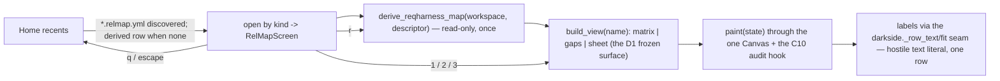

# Functionality — mapper — Batch 2026-10-25-relmap-r2-batch

> **Artifact language:** English (`state.json` `language`).
> Phase 6 artifact. Owner: `docs-writer`. Audience: technical stakeholder. Evidence: behaviours were read in the code at `5520508` and in `04-validation.md`; the samples are the stored P4 walkthrough (`evidence/p4-ux-walkthrough-2026-10-26.txt`, executed 2026-10-26 on the code-identical `cdc4491`), not re-run in this unit.

## 🔑 At a glance (read first)

- **What this batch added:** the relation-map SCREENS on top of the R1 engine: a new `mapper/screens/relmap/` package (host + three renderers) and a presentation leaf `mapper/relmap/text.py`; the Home shell lists and opens relation maps; the `SCOPE_RELMAP` keymap seat; a 240-character per-line bound on the `--audit` hook lines.
- **Capabilities:** matrix view with the two-hop impact lens and binds-glyphs cells · ranked gaps catalogue with the `k` by-kind grouping (byte-identical toggle-back) · node sheet with direct/stacked (`c`) reachability and the node's own gaps · Home integration (kind badges, derived row, routing by descriptor kind, read-only) · seat-generated chrome (keybar/help/palette can never drift from the keys) · hostile-payload literal rendering at every label seam.
- **How to use it:** launch `mapper` in a workspace whose root holds `REQUIREMENTS.md` (a `*.relmap.yml` descriptor is optional); on Home, move to a `relation·reqharness` row and press `↵`.

> Enough to know what shipped and how to reach it. Detail below for how it works.

---

## Detail (reference)

### How it works (flow)



1. Home's recents list interleaves tree maps (`*.mmd`), relation maps (repo-root `*.relmap.yml`, badge ` relation·reqharness `) and, when no descriptor exists, one derived row for the workspace canon. One list, name-sorted across kinds; row keys are kind-prefixed so kinds can never collide.
2. `↵` routes by row kind: a relation row opens `RelMapScreen`, which derives the map once (default descriptor values; a non-git workspace works — the canon resolves at the workspace root), keeps the app alive on any refusal (the closed-set `structure: refused (…)` line, never `str(exc)` or a path), and writes nothing.
3. The host owns ONE CLAMPED CURSOR PER VIEW on that view's own axis (node list for matrix/sheet, ranked-gap rows for gaps), no wrap; the crumb names the active view and its own toggle word (`demo / relmap / matrix · panel lens`, `… · stacked chain`), never another view's state.
4. The three renderers (`matrix.py`, `gaps.py`, `sheet.py`) implement the PDR-frozen host↔renderer surface (`ViewState`, `paint(state)`, `toggle(kind) -> str`, `row_count(state) -> int`) and share the base painters: column cuts, evidence glyphs, and the single markup-safe label assembly seam.
5. Every label that carries canon- or descriptor-derived text is coerced through `darkside._row_text`/`fit` (LF/TAB/CR → single space) into explicit-style `Text`, so a bracket, ESC or control payload renders byte-literally on one row with no style leak.

### The keys (the `SCOPE_RELMAP` seat — one source for the keybar, help and palette)

| Key | On the relation screen | Inert off its home view |
|---|---|---|
| `↑`/`↓`/`←`/`→` | move the selection on the active view's own axis | — |
| `1` / `2` / `3` | switch to matrix / gaps / sheet | — |
| `enter` | focus the matrix lens (the two-hop impact panel) | yes (matrix only) |
| `c` | the sheet's chain density: direct ⇄ stacked | yes (sheet only) |
| `k` | the gaps by-kind grouping: ranked ⇄ by-kind (toggle-back byte-identical) | yes (gaps only) |
| `r` | re-derive the map from disk (count goes 1 → 2) | — |
| `q` / `escape` | leave (escape is the quiet alias) | — |
| `?` / `ctrl+p` | help / palette — list exactly the seat's relmap rows | inherited app scope |

The seat is additive (`mapper/keymap.py`, 13 bindings, no chord twice, pinned by the whole-seat census and the seat-conformance tests): no hand-written binding, help row or palette entry can exist outside it.

### How to read the screens (samples from the executed walkthrough, fixture `demo`)

**Matrix.** One row/column per node; the cell glyph names the strongest connection between a pair — `●` bound with evidence, `◐` bound without, `○` unbound, `•` refines, `≡` covers; the legend names `✓ verifies · ! evidence missing · · no verifies edge`. The selection rides a window with a two-digit ruler and an `NN out of view` declaration; out-of-window columns are declared, never silently dropped. The body carries the honest declaration `no test columns yet — the AT→test table (B-141) feeds this view` until the AT→test source exists. `enter` opens the lens: `change HLR-DEMO.2 reaches 2 nodes · hop 1: 2 direct · hop 2: 0 chained` with the reach gauge; rows outside the two-hop neighbourhood paint FAINT; a spent budget paints `not computed` with an empty gauge — no fabricated digits.

**Gaps.** Header `gaps — what the record does not say · ranked by severity, then reach ↓`; tally chips `high 0 med 1 low 0 total 1`; each row `NN <kind> <id> <sentence> <reach> <severity>` with the cursor on the worst gap. WHAT values cut at the width boundary with `…`, keeping `reach`/`status` intact; a cut row is declared, an overflow counts (`+NN above`); an honest `000` reach is a computed zero, and a spent budget tallies `not computed` rather than guessing. `k` regroups into per-kind bands (`hlr without llr med ×1`) with the grouping hint; toggling back is byte-identical. An empty record paints `no gaps on record` with zero chips.

**Node sheet.** Two-row header `id · title` + the kind chip (no source/path segment). `feeds it` lists exactly the oracle `up` rows (`↑1 refines HLR-DEMO.1`); `a change reaches` the `down` rows; a section with nothing to show paints a declared empty line, never a fudge. `c` flips to the stacked chain — every node by minimum hop (`↑2 …`), the hop-2 cut line `╌╌ +01 more upstream at hop 2 — c shows the chain` (direct-only cuts, counts zero-padded, omitted at 0) — and back. `gaps on this node` lists exactly the focused node's gaps. Hostile text anywhere paints byte-literally on one row.

**The unavailable state.** A refused descriptor or canon never crashes: one closed-set line (`structure: refused (demo): looks binary - descriptor skipped`), `relmap=None`, app alive, `q` returns Home. (Known cosmetic: the line paints twice — host strip + renderer body, B-163.)

**The 87-column check.** Every view re-verified at 87×34: every line ≤ 87 cells, the lens summary cuts inside the panel, the crumb and keybar stay inside the canvas, and the keybar truncates with the declared `… +N ? all keys`.

### Components / modules touched
| Module | Role in this batch |
|--------|--------------------|
| `mapper/screens/relmap/screen.py` | `RelMapScreen` host: derive-on-open + `r`, view switching, per-view cursors/crumb, the refusal notice, BINDINGS/keybar generation |
| `mapper/screens/relmap/base.py` | the shared painters + the `ViewState`/`RelMapView` frozen surface + the single markup-safe label sink |
| `mapper/screens/relmap/matrix.py` | the matrix renderer: window/ruler, the D5 glyph table, the lens summary/gauge/dimming, the declared test-column line |
| `mapper/screens/relmap/gaps.py` | the ranked gaps renderer: chips, row anatomy, the WHAT drop rule, the `k` by-kind bands, honest zeros |
| `mapper/screens/relmap/sheet.py` | the node-sheet renderer: section oracles, the `c` stacked density, hop-2 cuts, the gaps band, width/overflow discipline |
| `mapper/relmap/text.py` (new leaf) | `cut`, `DISPLAY_MAX`, `refusal_line` — one definition site, one import path (AT-150), bytes unchanged (AT-151) |
| `mapper/relmap/{model,descriptor,audit,adapter}.py` | the three primitives re-point at the leaf; zero old-path readers; the adapter's workspace-root canon resolution (LLR-RVH.3.3) |
| `mapper/keymap.py` | the additive `SCOPE_RELMAP` seat (13 bindings incl. `k`; uniqueness census; help/palette seat-equality) |
| `mapper/screens/home.py` · `mapper/app.py` | relation rows listed/badged/routed by kind; the `relmap.descriptor` discovery edge |
| `mapper/reqharness/audit.py` | the 240 per-line bound (`_cut_hook_line`, 239 + ellipsis on a spelling boundary, cut AFTER escaping) |

The tree `Graph` is untouched by construction (ARCHITECTURE R-016); the R1 frozen API (`PDR-2026-10-25-relmap-r1-batch#D3`) is consumed exactly (the R1 suite re-derived green, 49 → 49).

### Usage / examples

```text
mapper            # launch in the workspace; Home lists tree + relation rows
# on Home: j / arrows to a relation·reqharness row, ↵ to open
# 1 / 2 / 3 views · enter lens · k by-kind · c chain · r refresh · q leave
mapper --audit <repo>   # unchanged but for the bounded structure block (R1) and the 240-bound hook lines
```

### Diagrams
The flow above (Mermaid, inline). No separate `06-docs/diagrams/` files: one diagram carries the whole flow.

### Limits and known gaps
- Python 3.10 real run: **not-run** (B-165); the floor rests on an AST guard and a banned-name census.
- The matrix declares `no test columns yet`: the full `AT × TC` graduated-binds grid awaits the B-141 AT→test table; the synthetic-map census (AT-133) carries the fidelity meanwhile.
- Home recents kind/name columns paint clipped at both widths (`rel`/`leg`, `REQUIR`) — paint-only; stored cells carry full values (B-159).
- The hook bound counts code points, not display cells (wide-glyph lines up to ~480 cells); B-161 owns the decision.
- The M-RVM-4 mutant id is a declared numbering gap (B-162); the refusal line's double paint is parked (B-163); the by-kind mid-band split is unsignalled (B-160).
- Two accepted deviations with the shipped behaviour normative: the two-hatch cut line (D-1, ratified at the DDR) and code-points-not-cells (D-2).

### Evidence checklist — docs-writer
- Audience and purpose declared at the top: ✓ header of both files.
- Structure follows the flow templates (`functionality-template.md`, `executive-summary-template.md`): ✓ sections kept; the diagram stays inline.
- Snippets actually run: ✗ partial — the samples are the stored executed P4 walkthrough (privacy-sanitized), not re-run in this unit; the key table is read from the sealed seat (`mapper/keymap.py`), not re-pressed.
- Assumptions listed: ✓ (documented from records and code, not re-execution).
- Risks / limitations: ✓ "Limits and known gaps".
- Next steps: ✓ executive summary table.
- Diagrams where flow is non-trivial: ✓ one Mermaid flow.
- No invented APIs / versions / metrics: ✓ names read from `mapper/screens/relmap/*.py` and the seat; figures from `04-validation.md`, the DDR and the walkthrough transcript.
